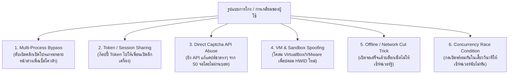
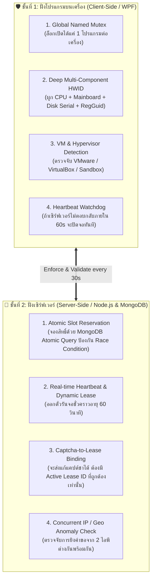
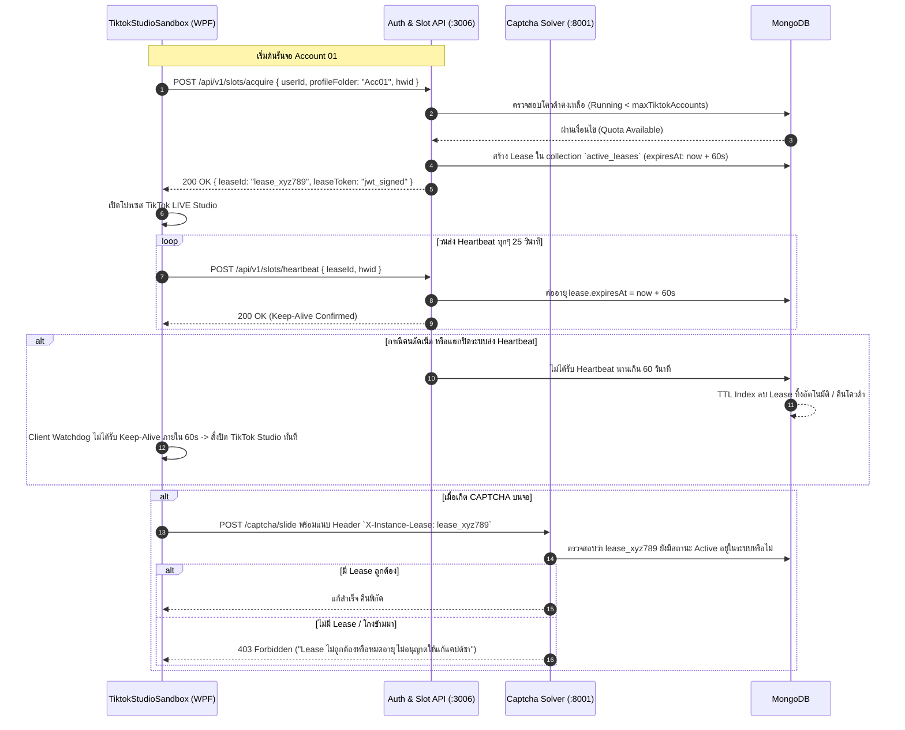

# 10. Anti-Circumvention & Account Enforcement Architecture

เอกสารออกแบบ **ระบบป้องกันการลักลอบเปิดหลายบัญชีเกินโควต้า (Anti-Circumvention / Anti-Cheat System)** เพื่อควบคุมการใช้งานบัญชีอย่างเข้มงวด ป้องกันการโกง/การเหลี่ยมจากผู้ใช้ ครอบคลุมทั้ง **ฝั่งโปรแกรมบนเครื่อง (Client WPF Application)** และ **ฝั่งระบบเซิร์ฟเวอร์ (Backend & MongoDB Architecture)**

---

## 1. วิเคราะห์รูปแบบการ "เหลี่ยม" ของผู้ใช้งาน (Threat & Exploit Vectors)

จากการวิเคราะห์พฤติกรรมของผู้ใช้ที่ต้องการหลบเลี่ยงข้อจำกัด `maxTiktokAccounts` หรือ `deviceLimit` พบช่องทางหลัก 6 รูปแบบ:



---

## 2. ยุทธศาสตร์ป้องกันแบบสองชั้น (Defense-in-Depth Model)

ระบบจะใช้มาตรการ **"Client-Server Mutual Enforcement"** โดยไม่เชื่อใจไคลเอนต์เพียงฝ่ายเดียว (Zero Trust Client):



---

## 3. สถาปัตยกรรมป้องกันฝั่งโปรแกรม (Client-Side Protections)

### 3.1 การล็อก Single Instance ด้วย Global Named Mutex
ป้องกันผู้ใช้เปิดโปรแกรม `TiktokStudioSandbox.exe` ซ้อนกันหลายตัวเพื่อหลอกรันจอเกิน:

```csharp
// App.xaml.cs
public partial class App : Application
{
    private static Mutex? _singleInstanceMutex;

    protected override void OnStartup(StartupEventArgs e)
    {
        const string mutexName = @"Global\TiktokStudioSandbox_SingleInstance_Mutex_2026";
        _singleInstanceMutex = new Mutex(true, mutexName, out bool createdNew);

        if (!createdNew)
        {
            MessageBox.Show(
                "โปรแกรม TikTok LIVE Studio Sandbox กำลังทำงานอยู่แล้วในระบบ\nไม่สามารถเปิดโปรแกรมซ้ำซ้อนได้",
                "แจ้งเตือนความปลอดภัย",
                MessageBoxButton.OK,
                MessageBoxImage.Warning
            );
            Current.Shutdown();
            return;
        }

        base.OnStartup(e);
    }
}
```

### 3.2 Deep Hardware ID (ป้องกันการสปูฟ MAC/IP)
สร้างลายนิ้วมือเครื่องแบบลึก โดยรวมฮาร์ดแวร์ที่ไม่สามารถเปลี่ยนได้ง่ายเข้าด้วยกัน:
1. **Motherboard Serial Number** (`Win32_BaseBoard`)
2. **CPU Processor ID** (`Win32_Processor`)
3. **Primary Disk Physical Serial** (`Win32_DiskDrive`)
4. **Windows MachineGuid** (`HKLM\SOFTWARE\Microsoft\Cryptography`)

```csharp
// DeepHWIDGenerator.cs
public static string GenerateDeepHwid()
{
    string mbSerial = ReadWmi("Win32_BaseBoard", "SerialNumber");
    string cpuId = ReadWmi("Win32_Processor", "ProcessorId");
    string diskSerial = ReadWmi("Win32_DiskDrive", "SerialNumber");
    string machineGuid = ReadRegistryMachineGuid();

    string rawPayload = $"{mbSerial}|{cpuId}|{diskSerial}|{machineGuid}";
    
    using var sha256 = SHA256.Create();
    byte[] hashBytes = sha256.ComputeHash(Encoding.UTF8.GetBytes(rawPayload));
    return Convert.ToHexString(hashBytes); // SHA-256 Signature
}
```

### 3.3 ตรวจจับ Virtual Machine & Hypervisor (VM Detection)
ตรวจจับว่าผู้ใช้กำลังรันใน VirtualBox, VMware, หรือ Sandbox หรือไม่ (เลือกเปิด/ปิดได้ในระดับนโยบายของแอดมิน):
* เช็ก Manufacturer ใน `Win32_ComputerSystem`: `"VMware"`, `"VirtualBox"`, `"QEMU"`, `"Xen"`
* เช็ก Driver / Module ในหน่วยความจำ: `VBoxMouse.sys`, `vmmouse.sys`, `vboxguest.sys`

---

## 4. สถาปัตยกรรมป้องกันฝั่งเซิร์ฟเวอร์ (Server-Side Protections)

### 4.1 ระบบเช่าสิทธิ์แบบเรียลไทม์ (Dynamic Instance Lease & Heartbeat)
> ⚠️ **กฎเหล็ก:** เซิร์ฟเวอร์จะไม่อนุญาตให้รันจอแบบถาวร แต่จะออก **"ตั๋วเช่าชั่วคราว (Instance Lease)" ที่มีอายุสั้นเพียง 60 วินาที**



---

### 4.2 ป้องกัน Race Condition ด้วย MongoDB Atomic Slot Allocation
ป้องกันกรณีผู้ใช้เปิดหลายหน้าต่างพร้อมกันแล้วกดยิงขอเปิด 10 จอในระดับมิลลิวินาทีเดียวกัน โดยใช้ **Atomic Conditional Upsert/Update**:

```typescript
// services/slotService.ts
export const acquireInstanceSlot = async (
  userId: number,
  profileFolderName: string,
  hwid: string
): Promise<{ success: boolean; leaseId?: string; error?: string }> => {
  // 1. ดึงโควต้าของ User
  const user = await User.findOne({ userId });
  if (!user || user.status !== 'active') {
    return { success: false, error: 'บัญชีไม่พร้อมใช้งานหรือหมดอายุ' };
  }

  // 2. ถ้าเป็น root ไม่จำกัด
  const maxAccounts = user.isSystemRoot ? 9999 : user.license.maxTiktokAccounts;

  // 3. นับจำนวน Lease ปัจจุบันที่ยัง Active
  const now = new Date();
  const currentActive = await ActiveLease.countDocuments({
    userId,
    expiresAt: { $gt: now }
  });

  if (currentActive >= maxAccounts) {
    return { 
      success: false, 
      error: `เกินโควต้าบัญชีสูงสุดแล้ว (เปิดอยู่ ${currentActive}/${maxAccounts} บัญชี)` 
    };
  }

  // 4. จอง Slot ด้วย Atomic Operation (Upsert ตาม profileFolderName)
  const leaseId = `lease_${crypto.randomBytes(16).toString('hex')}`;
  const expiresAt = new Date(Date.now() + 60 * 1000); // อายุ 60 วินาที

  await ActiveLease.findOneAndUpdate(
    { userId, profileFolderName },
    {
      $set: {
        leaseId,
        hwid,
        expiresAt,
        updatedAt: now
      },
      $setOnInsert: { createdAt: now }
    },
    { upsert: true, new: true }
  );

  return { success: true, leaseId };
};
```

---

### 4.3 การผูกระบบแก้ Captcha เข้ากับ Active Lease (Captcha Gatekeeper)
แก้ปัญหาคนเหลี่ยม **แอบเปิด TikTok Studio เองข้างนอก แล้วยิงขอแก้ Captcha มารวมที่ API เดียว**:

ในไฟล์ `SimpleSolveCaptchaProject/src/middlewares/auth.ts`:
```typescript
export const verifyActiveLease = async (req: Request, res: Response, next: NextFunction) => {
  const leaseId = req.headers['x-instance-lease'] as string;
  const userId = req.userId;

  if (!leaseId) {
    return res.status(403).json({ 
      error: 'ปฏิเสธการให้บริการ: ต้องแนบ X-Instance-Lease ของจอที่ได้รับอนุญาตเท่านั้น' 
    });
  }

  // เช็กว่า Lease นี้มีตัวตนใน DB และยังไม่หมดเวลาหรือไม่
  const activeLease = await ActiveLease.findOne({
    leaseId,
    userId,
    expiresAt: { $gt: new Date()}
  });

  if (!activeLease) {
    return res.status(403).json({ 
      error: 'Lease หมดอายุหรือตรวจพบการใช้งานนอกระบบที่ได้รับอนุญาต' 
    });
  }

  next();
};
```

---

## 5. MongoDB Schema เพิ่มเติมสำหรับระบบความปลอดภัย

### Collection: `active_leases` (เก็บตั๋วที่กำลังรันอยู่แบบ Real-time)
ใช้ **TTL Index** ให้ MongoDB กวาดลบทิ้งอัตโนมัติหากเครื่อง Client ดับหรือตัดเน็ตไป

```typescript
export interface IActiveLease extends Document {
  leaseId: string;                     // 'lease_a1b2c3d4...'
  userId: number;
  profileFolderName: string;           // 'Acc01'
  hwid: string;                        // เครื่องที่กำลังรันจออยู่
  ipAddress: string;
  expiresAt: Date;                     // เวลาที่จะหมดอายุ (ต่ออายุทุก Heartbeat)
  createdAt: Date;
}

const ActiveLeaseSchema = new Schema<IActiveLease>({
  leaseId: { type: String, required: true, unique: true },
  userId: { type: Number, required: true, index: true },
  profileFolderName: { type: String, required: true },
  hwid: { type: String, required: true },
  ipAddress: { type: String, default: '' },
  expiresAt: { type: Date, required: true }
}, { timestamps: true });

// 🚀 TTL Index: ลบข้อมูลทิ้งทันทีที่ expiresAt มาถึง
ActiveLeaseSchema.index({ expiresAt: 1 }, { expireAfterSeconds: 0 });
ActiveLeaseSchema.index({ userId: 1, profileFolderName: 1 }, { unique: true });
```

### Collection: `security_events` (เก็บบันทึกพฤติกรรมน่าสงสัย / ตรวจจับการโกง)

```typescript
export interface ISecurityEvent extends Document {
  userId: number;
  eventType: 'MULTIPLE_INSTANCE_ATTEMPT' | 'HWID_MISMATCH' | 'CONCURRENT_IP' | 'EXPIRED_LEASE_ABUSE';
  details: Record<string, any>;
  ipAddress: string;
  hwid?: string;
  severity: 'low' | 'medium' | 'high' | 'critical';
  createdAt: Date;
}

const SecurityEventSchema = new Schema<ISecurityEvent>({
  userId: { type: Number, required: true, index: true },
  eventType: { type: String, required: true },
  details: { type: Schema.Types.Mixed, default: {} },
  ipAddress: { type: String, required: true },
  hwid: { type: String, default: '' },
  severity: { type: String, enum: ['low', 'medium', 'high', 'critical'], default: 'medium' }
}, { timestamps: { createdAt: true, updatedAt: false } });

// เก็บย้อนหลัง 60 วันเพื่อการตรวจสอบของแอดมิน
SecurityEventSchema.index({ createdAt: 1 }, { expireAfterSeconds: 5184000 });
```

---

## 6. ตารางสรุปมาตรการรับมือแต่ละรูปแบบการโกง

| รูปแบบการเหลี่ยมของผู้ใช้ | จุดตรวจจับ (Layer) | กลไกป้องกันที่ใช้ | ผลลัพธ์เมื่อพยายามโกง |
| :--- | :--- | :--- | :--- |
| **ดับเบิลคลิกเปิดโปรแกรม 2 จอ** | Client (WPF) | Global Named Mutex | โปรแกรมที่ 2 เปิดไม่ติด แสดงกล่องแจ้งเตือนทันที |
| **ส่งคำขอเปิด 10 จอพร้อมกัน (Race)** | Server (API) | MongoDB Atomic Reservation | รับได้แค่ตาม `maxTiktokAccounts` ที่เหลือโดน 403 Forbidden |
| **ก๊อปปี้ Token ไปให้เพื่อนรัน** | Server (Auth) | Single HWID Concurrency Binding | เครื่องเพื่อนถูกบล็อกเพราะ HWID ไม่ตรงกับ Session โควต้า |
| **เปิดจอแล้วตัดเน็ตแช่ไว้** | Client + Server | Lease Token (60s) + Heartbeat Watchdog | ผ่านไป 60 วิ บอทฝั่งไคลเอนต์สั่งปิด TikTok Studio อัตโนมัติ |
| **ยิงแก้แคปต์ชาตรงๆ จากข้างนอก** | Server (Captcha) | Active Lease Verification (`X-Instance-Lease`) | ปฏิเสธคำขอ 403 ทันทีเพราะไม่มี Lease ที่กำลังรันจริงในระบบ |
| **รันผ่าน VM เพื่อปั๊ม HWID ปลอม** | Client (Kernel) | Hypervisor & Virtualization Driver Scanner | ล็อกไม่ให้โปรแกรมทำงานบนสภาพแวดล้อม VM |

---

## 7. แผนการนำไปติดตั้งใช้งาน (Implementation Roadmap)

1. **เฟสที่ 1 (WPF Client Lock):**
   * เพิ่มโค้ด `Global Mutex` ใน `App.xaml.cs`
   * รวมฮาร์ดแวร์ 4 ชิ้นสร้าง `DeepHWIDGenerator` ส่งไปพร้อมคำขอ Login
2. **เฟสที่ 2 (Backend Lease & Heartbeat Engine):**
   * สร้าง Collection `active_leases` พร้อม TTL Index ใน MongoDB
   * เพิ่ม Endpoints:
     * `POST /api/v1/slots/acquire` (ขอเปิดจอ)
     * `POST /api/v1/slots/heartbeat` (ต่ออายุจอทุก 25 วินาที)
     * `POST /api/v1/slots/release` (เมื่อผู้ใช้กดปิดจอด้วยตัวเอง)
3. **เฟสที่ 3 (Captcha Solver Gatekeeper):**
   * ปรับแก้ `src/middlewares/auth.ts` ใน `SimpleSolveCaptchaProject` ให้ตรวจสอบ Header `X-Instance-Lease` จากตาราง `active_leases`
4. **เฟสที่ 4 (Admin Security Dashboard):**
   * เพิ่มหน้าแสดงผลใน Backoffice แสดง Real-time Active จอที่กำลังรันอยู่ และปุ่ม `Force Terminate Slot` สำหรับแอดมิน
