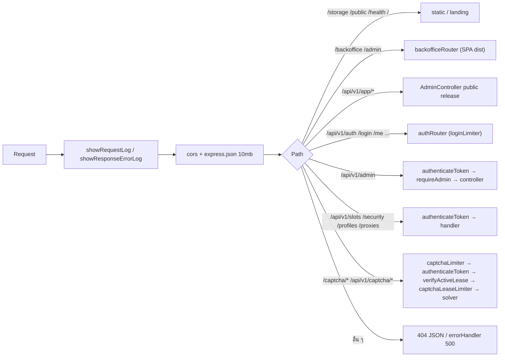

# FlowUltraTech Backend — ภาพรวมและวิธีรัน

อัปเดตล่าสุด: 2026-10-20 · เวอร์ชัน backend: 1.0.0 (`package.json` ชื่อ `flowultratech-backend`) · เวอร์ชันแอป client ที่ใช้งานร่วมกัน: 1.7.0

Backend กลางของแอป desktop FlowUltraTech (C# WPF) ทำหน้าที่ 5 อย่างในโปรเซสเดียว: **Auth/License**, **Slot Lease (โควต้าจอ)**, **AI Captcha Solver** (slide และ symbol), **Realtime hub (Socket.io)** และ **Backoffice + ระบบแจกจ่ายตัวติดตั้ง/อัปเดต**

> เอกสารนี้เขียนใหม่จากโค้ดจริง เอกสารเก่าที่ล้าสมัยอยู่ที่ [`archive/`](archive/) (`mongodb_schema_and_auth.md`, `10_anti_circumvention_and_account_enforcement.md`) ใช้อ้างอิงประวัติเท่านั้น ห้ามเชื่อถือ

## เอกสารในโฟลเดอร์นี้

| ไฟล์ | เนื้อหา |
| --- | --- |
| [api_reference.md](api_reference.md) | ตาราง endpoint ทุกตัว แยกตาม router + Socket.io events + rate limit |
| [data_model.md](data_model.md) | Mongoose models ทั้ง 9 ตัว, index, TTL, erDiagram |
| [operations_and_backoffice.md](operations_and_backoffice.md) | bootstrap, cache, audit log, security events, Telegram, Backoffice, release/deploy scripts |

เอกสารฝั่ง client (repo `d:\Script\Test\FlowUltraTech`) อยู่ที่ [11_auth_license_and_security.md](file:///d:/Script/Test/FlowUltraTech/docs/11_auth_license_and_security.md) และ [12_build_release_and_testing.md](file:///d:/Script/Test/FlowUltraTech/docs/12_build_release_and_testing.md)

## Stack

| ส่วน | เทคโนโลยี (จาก [package.json](../package.json)) |
| --- | --- |
| Runtime / ภาษา | Node.js, TypeScript 5 (`"type": "module"`, target ES2022, output `dist/`) |
| Web | Express 4, `cors` (เปิดทุก origin), `express-rate-limit`, `multer` (อัปโหลดตัวติดตั้ง จำกัด 500 MB) |
| DB | MongoDB ผ่าน Mongoose 9 |
| Auth | `jsonwebtoken` (HS256), `bcryptjs` (cost 10) |
| Realtime | `socket.io` 4 (transport: websocket + polling) |
| Validation env | `zod` ([src/config/env.ts](../src/config/env.ts)) |
| Captcha slide | ONNX Runtime (`onnxruntime-node`) + `sharp`, โมเดล `models/jigsaw-model.onnx` ([src/ml/slide.ts](../src/ml/slide.ts)) |
| Captcha symbol | Python daemon FastSAM + DINOv2 ([python/symbol_service.py](../python/symbol_service.py)) เรียกผ่าน HTTP พอร์ต `SYMBOL_SERVICE_PORT` (default 3008) จาก [src/ml/symbol.ts](../src/ml/symbol.ts) |
| Backoffice | React + Vite (build แล้วเสิร์ฟจาก `backoffice/dist`) |

## โครงสร้างโฟลเดอร์

```text
FlowUltraTech/                     (backend repo)
├─ src/
│  ├─ server.ts            จุดเริ่มต้น: connect DB → bootstrap → HTTP + Socket.io → prewarm Python daemon
│  ├─ app.ts               ประกอบ Express app + mount routes
│  ├─ config/              env.ts (zod), db.ts (mongoose)
│  ├─ routes/              auth, admin, backoffice, captcha, profiles, proxies, security, slots
│  ├─ controllers/         adminController.ts (user/lease/log/release ทั้งหมดของ /admin + public release)
│  ├─ middlewares/         auth.ts, protectRoot.ts, request.ts, error.ts
│  ├─ models/              User, RefreshToken, ActiveLease, InstanceProfile, Proxy, CaptchaLog, SecurityEvent, AuditLog, AppRelease
│  ├─ services/            socketHub, auditLogger, cacheManager, bootstrap, telegramService
│  ├─ ml/                  slide.ts (ONNX), symbol.ts (ตัวเรียก Python), onnx.ts, cv.ts (stub ไม่ใช้งาน)
│  └─ utils/               versionDetector.ts, image.ts, imageOverlay.ts
├─ backoffice/dist/        build ของ Backoffice (ไม่มี source ใน repo นี้ — ดู operations_and_backoffice.md)
├─ python/                 symbol_service.py + solver ของ slide/symbol (โมเดล .pt/.onnx ไม่อยู่ใน git)
├─ models/                 jigsaw-model.onnx (ไม่อยู่ใน git)
├─ public/                 landing page (index.html) + ไอคอน
├─ storage/                captchas/ (รูปที่ผู้ใช้ส่งแก้) และ releases/ (ตัวติดตั้ง .exe) — ไม่อยู่ใน git
├─ scripts/                deploy_update.py, fix_releases_metadata.py, verify_live.py, reset_and_seed_db.ts, sync_expired_at.ts, benchmark_simulation.py
├─ tests/                  สคริปต์ทดสอบ .mjs / .ts / .py (ไม่มี test runner กลาง)
├─ docs/                   เอกสารนี้ + archive/
├─ .env.example            ตัวอย่างชื่อ env var
└─ dist/                   ผล `tsc` (gitignored)
```

## ลำดับการทำงานของ request



ลำดับ mount จริงอยู่ใน [src/app.ts](../src/app.ts) (`buildApp`) สังเกต: `authRouter` ถูก mount ทั้งที่ `/api/v1/auth` และที่ root (alias เก่า `/login`, `/me`, `/refreshToken`, `/settings`, `/logout`) และ `captchaRouter` ถูก mount ทั้งที่ root กับ `/api/v1`

## วิธีรัน

| งาน | คำสั่ง | หมายเหตุ |
| --- | --- | --- |
| ติดตั้ง | `npm install` | ต้องมี MongoDB และไฟล์ `.env` (ดูตัวแปรด้านล่าง) |
| Dev (watch) | `npm run dev` | `tsx watch src/server.ts` |
| Build | `npm run build` | `tsc` → `dist/` |
| Production | `npm start` | `node dist/server.js` (จำเป็นต้อง build ก่อน) |
| Deploy | `npm run deploy` | `python scripts/deploy_update.py` — **อัปโหลดขึ้นเซิร์ฟเวอร์จริงผ่าน SSH และ restart PM2** ห้ามรันโดยไม่ตั้งใจ (ดู operations_and_backoffice.md) |
| Test | `npm test`, `test:simple`, `test:symbol`, `test:all`, `test:backend` | ดูตารางด้านล่าง |

พอร์ตเริ่มต้น 8001 (`PORT`) เมื่อ listen สำเร็จจะส่ง `process.send("ready")` (ให้ PM2 รู้) และรองรับ graceful shutdown (SIGTERM/SIGINT, บังคับออกหลัง 10 วินาที)

### Test scripts ใน `package.json`

| script | ไฟล์ | สิ่งที่ทำ / ข้อควรระวัง |
| --- | --- | --- |
| `npm test` | `tests/test-captcha-api.mjs` | ยิง captcha API ผ่าน HTTP โดยอ้างพอร์ต 3005/3006 (ค่าเก่า ไม่ตรงกับ 8001 ของปัจจุบัน) |
| `test:simple` | `tests/test-simple.mjs` | login + โหลดรูป + solve แบบเรียบง่าย (พอร์ต 3005/3006 เช่นกัน) |
| `test:symbol` | `tests/test-symbol.mjs` | ทดสอบ symbol (รับ `AUTH_URL`/`CAPTCHA_URL` จาก env) |
| `test:all` | `tests/test-all-images.mjs` | batch ทดสอบรูปทั้งหมด (path อ้างโฟลเดอร์เก่า `_archive/...`) |
| `test:backend` | `tests/test-backend-full.mjs` | integration ที่ import `dist/*` ต้อง build ก่อน เปิดเซิร์ฟเวอร์ชั่วคราวพอร์ต 3009 ใช้ MongoDB local ฐาน `tiktok_sandbox` |

รายละเอียดการทดสอบทั้งหมดอยู่ใน [operations_and_backoffice.md](operations_and_backoffice.md#ชุดทดสอบ-tests)

## Environment variables (เฉพาะชื่อ)

| ตัวแปร | จำเป็น | ใช้ที่ | ใน `.env.example` |
| --- | --- | --- | --- |
| `JWT_TOKEN` | ใช่ (zod บังคับ ไม่งั้น process exit) | secret เซ็น/ตรวจ access token (HS256) | มี |
| `JWT_REFRESH_SECRET` | ไม่ (ถ้าไม่ตั้งจะใช้ `JWT_TOKEN`) | secret เซ็นส่วน JWT ภายใน refresh token | ไม่มี |
| `PORT` | ไม่ | พอร์ต HTTP (default 8001) | มี |
| `TRUST_PROXY` | ไม่ | `app.set("trust proxy", n)` มีผลกับ `req.ip` และ rate limit (default 1) | มี |
| `NODE_ENV` | ไม่ | `development` / `production` / `test` | มี |
| `MONGODB_URI` | ไม่ | connection string (default เป็น MongoDB บนเครื่อง ฐาน `flowultratech`) | มี (ค่าตัวอย่างชี้ฐาน `tiktok_sandbox` ซึ่งต่างจาก default ในโค้ด) |
| `ROOT_USERNAME`, `ROOT_PASSWORD`, `ROOT_EMAIL` | ไม่ (มี default ในโค้ด) | seed/ซิงก์ผู้ใช้ root ทุกครั้งที่ boot | มี |
| `TELEGRAM_DEFAULT_BOT_TOKEN` | ไม่ | bot token สำรองเมื่อผู้ใช้ไม่ได้ตั้งของตัวเอง | ไม่มี |
| `ENABLE_TEST_USER` | ไม่ | ค่า `"true"` จะ seed ผู้ใช้ทดสอบ `test` (อ่านด้วย `process.env` ตรง ๆ ใน [bootstrap.ts](../src/services/bootstrap.ts)) | ไม่มี |
| `SYMBOL_SERVICE_PORT` | ไม่ | พอร์ต Python symbol daemon (default 3008) | ไม่มี |
| `PYTHON_BIN` | ไม่ | path ของ python ที่ต้องการใช้ | ไม่มี |

## หัวข้อที่ควรรู้ก่อนแก้โค้ด

- ตัวระบุผู้ใช้ที่ทุก collection ใช้คือ `userId` (Number) ไม่ใช่ `_id` — root = `1000000` ผู้ใช้ใหม่เริ่มที่ `1000001`
- ระบบ **จำกัดจำนวนจอ (`license.maxTiktokAccounts`) ไม่ได้จำกัดจำนวนเครื่อง** — `license.deviceLimit` ยังเก็บและส่งกลับใน API แต่ไม่มีโค้ดฝั่ง login/refresh/slot ที่ใช้ตัดสินใจ (ดู [11_auth_license_and_security.md](file:///d:/Script/Test/FlowUltraTech/docs/11_auth_license_and_security.md))
- กลไกบังคับสิทธิ์ที่ server ตัดสินจริงคือ `slots/acquire` (นับจอ) และ `verifyActiveLease` (ต้องมี lease ถึงเรียก captcha ได้)

## ข้อสังเกต/ช่องว่าง (ยังไม่ยืนยันจากโค้ด)

- ไม่พบไฟล์ PM2 ecosystem ใน repo ชื่อ process `flowultratech-backend` มาจาก `scripts/deploy_update.py` เท่านั้น
- ไม่พบ reverse proxy / TLS config ใน repo ไม่ทราบว่าหน้าเซิร์ฟเวอร์จริงมี nginx หรือ HTTPS หรือไม่ (client ใช้ `http://` ตรง)
- ไม่พบ `requirements.txt` สำหรับ `python/` ไม่ทราบรายการ dependency ที่แน่ชัดของ FastSAM/DINOv2
