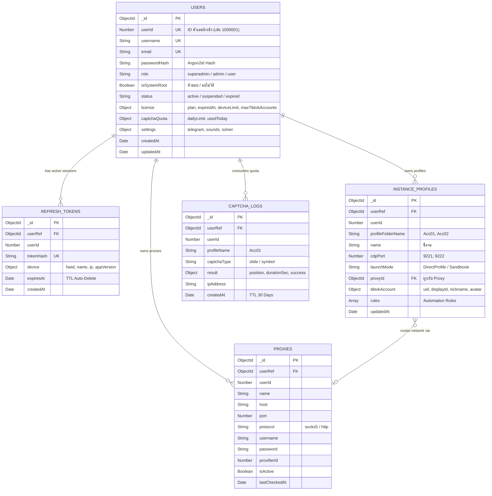
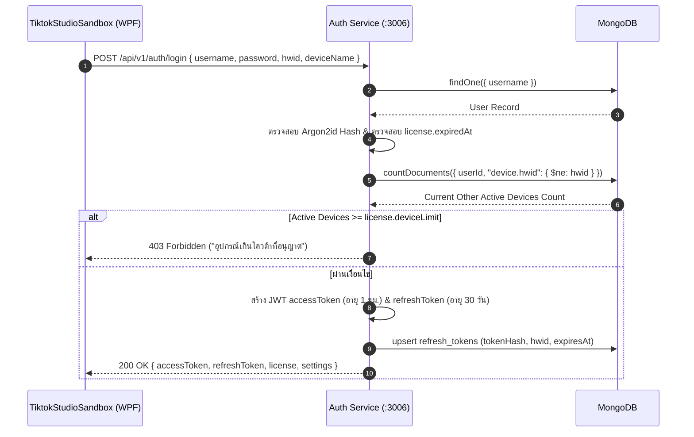

# 09. MongoDB Schema & Central Auth Architecture

เอกสารการออกแบบและสถาปัตยกรรมระบบฐานข้อมูล **MongoDB** ร่วมกับ **Central Authentication Service** สำหรับเชื่อมต่อระหว่าง **TikTok LIVE Studio Multi-Instance Sandbox (`TiktokStudioSandbox`)** และ **AI Captcha Solving Service (`SimpleSolveCaptchaProject`)**

---

## 1. บทนำและวัตถุประสงค์ (Overview & Objectives)

เดิมทีระบบทำงานในลักษณะแยกส่วน (Decentralized / Standalone):
* `TiktokStudioSandbox` บันทึกการตั้งค่า โปรไฟล์ และพร็อกซีลงในไฟล์เครื่องเฉพาะที่ (`config.json` ผ่าน `ConfigStorageService`)
* `SimpleSolveCaptchaProject` ใช้บริการยืนยันตัวตนแบบจำลองชั่วคราว (`standalone-auth-service.mjs`) ซึ่งเก็บผู้ใช้แบบ In-Memory บน `Map()`

การยกระดับสู่ระบบ **Centralized Database (MongoDB)** มีเป้าหมายเพื่อ:
1. **ระบบยืนยันตัวตนและจัดการสิทธิ์ (Authentication & Licensing):** รองรับระบบ Login ด้วย JWT (Access Token + Refresh Token), ควบคุมวันหมดอายุ (Subscription Expiration), และระดับสิทธิ์ (Role: Admin / User)
2. **การจำกัดอุปกรณ์และป้องกันการแชร์ไอดี (Device / HWID Binding):** จำกัดจำนวนเครื่องที่เปิดใช้งานพร้อมกัน (`deviceLimit`) โดยผูกกับ Hardware ID
3. **การสำรองและซิงค์ข้อมูลบนคลาวด์ (Cloud Config Sync):** บันทึกโปรไฟล์จอ (`instance_profiles`), พร็อกซี (`proxies`), และกฎตอบกลับอัตโนมัติ (`rules`) ผู้ใช้สามารถย้ายเครื่องคอมพิวเตอร์และดึงข้อมูลเดิมกลับมาได้ทันที
4. **บันทึกสถิติและโควต้าการแก้แคปต์ชา (Captcha Logging & Quota):** ตรวจสอบอัตราความสำเร็จ, สถิติเวลาเฉลี่ย, และการควบคุมโควต้ารายวัน

---

## 2. แผนผังสถาปัตยกรรมการไหลของข้อมูล (System Architecture Flow)

```mermaid
graph TD
    subgraph ClientLayer["🖥️ Desktop Client (WPF)"]
        WPF["TiktokStudioSandbox (Desktop App)"]
    end

    subgraph ServiceLayer["⚙️ Backend & API Services"]
        AuthService["Central Auth & Sync API\n(Node.js / Express :3006)"]
        CaptchaService["Captcha Solver API\n(Node.js / ONNX :8001)"]
    end

    subgraph DatabaseLayer["🗄️ Database (MongoDB Atlas / Self-Hosted)"]
        MongoUsers[("Collection: users")]
        MongoTokens[("Collection: refresh_tokens\n(TTL Index)")]
        MongoProfiles[("Collection: instance_profiles")]
        MongoProxies[("Collection: proxies")]
        MongoLogs[("Collection: captcha_logs\n(TTL Index 30 Days)")]
    end

    WPF -->|1. POST /login (User, Pass, HWID)| AuthService
    AuthService -->|Query & Verify Hash| MongoUsers
    AuthService -->|Check Active Devices| MongoTokens
    AuthService -->|Save New Session| MongoTokens
    AuthService -->>|Return Access & Refresh Token| WPF

    WPF -->|2. GET/PUT /profiles (Sync Cloud Config)| AuthService
    AuthService <-->|CRUD Profiles & Proxies| MongoProfiles
    AuthService <-->|CRUD Proxies| MongoProxies

    WPF -->|3. POST /captcha/slide with Bearer Token| CaptchaService
    CaptchaService -->|Verify JWT Secret / Check Quota| MongoUsers
    CaptchaService -->|Record Solve Result & Latency| MongoLogs
```

---

## 3. แผนภาพความสัมพันธ์ของข้อมูล (Entity-Relationship Diagram)



---

## 4. โครงสร้าง Schemas ทั้ง 5 คอลเลกชัน (Schema Definitions)

### 4.1 Collection: `users` (บัญชีผู้ใช้และใบอนุญาต)
ใช้สำหรับจัดเก็บตัวตนผู้ใช้งาน, สถานะสิทธิ์ (Subscription), โควต้าแคปต์ชา และการตั้งค่ากลาง

```typescript
import { Schema, model, Document, Types } from 'mongoose';

export interface IUser extends Document {
  userId: number;                       // 1000001
  username: string;
  email?: string;
  passwordHash: string;
  role: 'superadmin' | 'admin' | 'user';
  isSystemRoot: boolean;                // true = บัญชี Root ของระบบ (ห้ามลบ/แก้ไขสถานะ)
  status: 'active' | 'suspended' | 'expired';
  license: {
    plan: string;                       // 'standard' | 'pro' | 'enterprise' | 'unlimited_root'
    expiredAt: Date;                    // วันหมดอายุแพ็กเกจ
    deviceLimit: number;                // จำนวนเครื่องสูงสุดที่อนุญาตล็อกอินพร้อมกัน (Default: 1)
    maxTiktokAccounts: number;          // 🎯 จำนวนบัญชี TikTok Studio สูงสุดที่อนุญาตให้เปิดพร้อมกัน
  };
  captchaQuota: {
    dailyLimit: number;                 // โควต้าแก้แคปต์ชาต่อวัน (เช่น 500)
    usedToday: number;
    lastResetDate: Date;
  };
  settings: {
    telegramBotToken?: string;
    telegramChatId?: string;
    autoSolveDelaySeconds: number;
    captchaSoundVolume: number;
    autoSaveCaptchaImage: boolean;
  };
  createdAt: Date;
  updatedAt: Date;
}

const UserSchema = new Schema<IUser>(
  {
    userId: { type: Number, required: true, unique: true, index: true },
    username: { type: String, required: true, unique: true, trim: true, lowercase: true },
    email: { type: String, sparse: true, unique: true, trim: true, lowercase: true },
    passwordHash: { type: String, required: true },
    role: { type: String, enum: ['superadmin', 'admin', 'user'], default: 'user' },
    isSystemRoot: { type: Boolean, default: false },
    status: { type: String, enum: ['active', 'suspended', 'expired'], default: 'active', index: true },
    license: {
      plan: { type: String, default: 'standard' },
      expiredAt: { type: Date, required: true, index: true },
      deviceLimit: { type: Number, default: 1, min: 1 },
      maxTiktokAccounts: { type: Number, default: 2, min: 1 }
    },
    captchaQuota: {
      dailyLimit: { type: Number, default: 500 },
      usedToday: { type: Number, default: 0 },
      lastResetDate: { type: Date, default: Date.now }
    },
    settings: {
      telegramBotToken: { type: String, default: '' },
      telegramChatId: { type: String, default: '' },
      autoSolveDelaySeconds: { type: Number, default: 5 },
      captchaSoundVolume: { type: Number, default: 80 },
      autoSaveCaptchaImage: { type: Boolean, default: true }
    }
  },
  { timestamps: true }
);
```

---

### 4.2 Collection: `refresh_tokens` (เซสชันอุปกรณ์และคุม Device Limit)
เก็บ Token หมุนเวียน (Refresh Token) และระบุตัวตนเครื่องผ่าน Hardware ID (HWID) โดยใช้ **MongoDB TTL Index** เพื่อลบเซสชันที่หมดอายุออกโดยอัตโนมัติ

```typescript
export interface IRefreshToken extends Document {
  userRef: Types.ObjectId;
  userId: number;
  tokenHash: string;                   // แนะนำเก็บ SHA-256 Hash ของ Refresh Token
  device: {
    hwid: string;                      // รหัสฮาร์ดแวร์เครื่อง (CPU ID + Motherboard UUID)
    deviceName: string;                // เช่น DESKTOP-LIVE01
    ipAddress: string;
    appVersion: string;
  };
  expiresAt: Date;
  createdAt: Date;
}

const RefreshTokenSchema = new Schema<IRefreshToken>(
  {
    userRef: { type: Schema.Types.ObjectId, ref: 'User', required: true, index: true },
    userId: { type: Number, required: true, index: true },
    tokenHash: { type: String, required: true, unique: true },
    device: {
      hwid: { type: String, required: true },
      deviceName: { type: String, default: 'Unknown Device' },
      ipAddress: { type: String, default: '127.0.0.1' },
      appVersion: { type: String, default: '1.0.0' }
    },
    expiresAt: { type: Date, required: true }
  },
  { timestamps: { createdAt: true, updatedAt: false } }
);

// TTL Index: ลบเซสชันทิ้งทันทีเมื่อถึงวันหมดอายุ (expiresAt)
RefreshTokenSchema.index({ expiresAt: 1 }, { expireAfterSeconds: 0 });
// Compound Index: เช็กจำนวนเซสชันต่อเครื่องของผู้ใช้ได้ไว
RefreshTokenSchema.index({ userId: 1, 'device.hwid': 1 });
```

---

### 4.3 Collection: `instance_profiles` (โปรไฟล์ TikTok Studio & Automation Rules)
เก็บการตั้งค่ารายจอ ข้อมูล TikTok Account ที่ดึงมาจาก `services.json` และกฎการตอบกลับอัตโนมัติ

```typescript
export interface IInstanceProfile extends Document {
  userRef: Types.ObjectId;
  userId: number;
  name: string;                         // 'Account 01 (Gaming)'
  profileFolderName: string;            // 'Acc01'
  cdpPort: number;                      // 9221
  launchMode: 'DirectProfile' | 'Sandboxie';
  proxyId?: Types.ObjectId;
  customChromiumFlags?: string;
  tiktokAccount: {
    isLoggedIn: boolean;
    tiktokUid?: string;
    displayId?: string;                 // @displayId
    nickname?: string;
    avatarUrl?: string;
    lastSyncAt?: Date;
  };
  rules: Array<{
    id: string;
    name: string;
    isEnabled: boolean;
    triggerType: 'ChatKeyword' | 'GiftMinDiamonds' | 'MemberEnter';
    pattern?: string;
    isRegex?: boolean;
    minDiamonds?: number;
    responseTemplate: string;
    cooldownSeconds: number;
  }>;
  updatedAt: Date;
}

const InstanceProfileSchema = new Schema<IInstanceProfile>(
  {
    userRef: { type: Schema.Types.ObjectId, ref: 'User', required: true, index: true },
    userId: { type: Number, required: true },
    name: { type: String, required: true, trim: true },
    profileFolderName: { type: String, required: true, trim: true },
    cdpPort: { type: Number, required: true },
    launchMode: { type: String, enum: ['DirectProfile', 'Sandboxie'], default: 'DirectProfile' },
    proxyId: { type: Schema.Types.ObjectId, ref: 'Proxy', default: null },
    customChromiumFlags: { type: String, default: '' },
    tiktokAccount: {
      isLoggedIn: { type: Boolean, default: false },
      tiktokUid: { type: String, default: null },
      displayId: { type: String, default: null },
      nickname: { type: String, default: null },
      avatarUrl: { type: String, default: null },
      lastSyncAt: { type: Date, default: null }
    },
    rules: [
      {
        id: { type: String, required: true },
        name: { type: String, required: true },
        isEnabled: { type: Boolean, default: true },
        triggerType: { type: String, required: true },
        pattern: { type: String, default: '' },
        isRegex: { type: Boolean, default: false },
        minDiamonds: { type: Number, default: 1 },
        responseTemplate: { type: String, required: true },
        cooldownSeconds: { type: Number, default: 3 }
      }
    ]
  },
  { timestamps: true }
);

// 1 User จะมี profileFolderName ซ้ำกันไม่ได้
InstanceProfileSchema.index({ userId: 1, profileFolderName: 1 }, { unique: true });
```

---

### 4.4 Collection: `proxies` (รายการ Proxy ประจำบัญชี)

```typescript
export interface IProxyItem extends Document {
  userRef: Types.ObjectId;
  userId: number;
  name: string;                         // 'SOCKS5 Proxy #1'
  host: string;                         // '127.0.0.1'
  port: number;                         // 10808
  protocol: 'socks5' | 'http';
  username?: string;
  password?: string;
  proxifierId: number;                  // 101, 102
  isActive: boolean;
  lastCheckedAt?: Date;
  latencyMs?: number;
}

const ProxyItemSchema = new Schema<IProxyItem>(
  {
    userRef: { type: Schema.Types.ObjectId, ref: 'User', required: true, index: true },
    userId: { type: Number, required: true },
    name: { type: String, required: true },
    host: { type: String, required: true },
    port: { type: Number, required: true },
    protocol: { type: String, enum: ['socks5', 'http'], default: 'socks5' },
    username: { type: String, default: '' },
    password: { type: String, default: '' },
    proxifierId: { type: Number, required: true },
    isActive: { type: Boolean, default: true },
    lastCheckedAt: { type: Date, default: null },
    latencyMs: { type: Number, default: null }
  },
  { timestamps: true }
);

ProxyItemSchema.index({ userId: 1, proxifierId: 1 }, { unique: true });
```

---

### 4.5 Collection: `captcha_logs` (ประวัติการแก้แคปต์ชาและอัตราความสำเร็จ)
เก็บ Log ทุกครั้งที่ `SimpleSolveCaptchaProject` แก้แคปต์ชา โดยใช้ TTL Index 30 วันเพื่อประหยัดพื้นที่บน MongoDB Atlas

```typescript
export interface ICaptchaLog extends Document {
  userRef: Types.ObjectId;
  userId: number;
  profileFolderName?: string;
  captchaType: 'slide' | 'symbol';
  result: {
    position?: number[];                // [x, y]
    symbolPositions?: number[][];       // [[x1, y1], [x2, y2]]
    durationSec: number;
    success: boolean;
    errorMessage?: string;
  };
  clientIp: string;
  createdAt: Date;
}

const CaptchaLogSchema = new Schema<ICaptchaLog>(
  {
    userRef: { type: Schema.Types.ObjectId, ref: 'User', required: true, index: true },
    userId: { type: Number, required: true, index: true },
    profileFolderName: { type: String, default: 'Acc01' },
    captchaType: { type: String, enum: ['slide', 'symbol'], required: true },
    result: {
      position: { type: [Number], default: undefined },
      symbolPositions: { type: [[Number]], default: undefined },
      durationSec: { type: Number, required: true },
      success: { type: Boolean, required: true },
      errorMessage: { type: String, default: null }
    },
    clientIp: { type: String, default: '127.0.0.1' }
  },
  { timestamps: { createdAt: true, updatedAt: false } }
);

// TTL Index: ลบ Log เก่าทิ้งอัตโนมัติเมื่อครบ 30 วัน (2,592,000 วินาที)
CaptchaLogSchema.index({ createdAt: 1 }, { expireAfterSeconds: 2592000 });
// Compound Index: ดึงประวัติการแก้แคปต์ชาย้อนหลังของผู้ใช้
CaptchaLogSchema.index({ userId: 1, createdAt: -1 });
```

---

## 5. กระบวนการทำงานและการตรวจสอบสิทธิ์ (Authentication Workflows)

### 5.1 ขั้นตอน Login และตรวจสอบ Device Limit (Desktop App -> Auth Service)



### 5.2 ขั้นตอนขอแก้แคปต์ชา (Desktop App -> Captcha Solver)

1. เมื่อตรวจพบ Popup แคปต์ชาบน TikTok Studio, ตัวแอป `TiktokStudioSandbox` จะแปลงภาพเป็น Base64
2. ส่งคำขอ `POST http://127.0.0.1:8001/captcha/slide` พร้อม Header `Authorization: Bearer <accessToken>`
3. ใน `SimpleSolveCaptchaProject/src/middlewares/auth.ts`:
   * ถอดรหัส Token ตรวจสอบ `userId`
   * ตรวจสอบโควต้าคงเหลือใน DB `captchaQuota.usedToday < dailyLimit`
   * หลังแก้ภาพสำเร็จ ให้บันทึกเข้า `captcha_logs` และเพิ่ม `usedToday += 1`

---

## 6. แนวทางปฏิบัติด้านความปลอดภัย (Security & Implementation Notes)

### 1. ความเข้ากันได้ของ `userId` (Number vs ObjectId)
* ในโค้ดปัจจุบันของ `SimpleSolveCaptchaProject` (`src/middlewares/auth.ts` บรรทัดที่ 32):
  ```typescript
  if (typeof id !== "number") {
    res.status(400).json({ error: "Invalid user ID format" });
    return;
  }
  ```
* **คำแนะนำ:** การกำหนดให้ `users` collection มีฟิลด์ `userId: Number` (เช่น 1000001, 1000002) จะทำให้โค้ด Captcha Solver ปัจจุบันทำงานได้ทันทีโดยไม่ต้องแก้ Middleware
* หากต้องการใช้ `ObjectId` 24 ตัวอักษร ให้ปรับเป็น:
  ```typescript
  if (typeof id !== "string" && typeof id !== "number") { ... }
  ```

### 2. การสร้าง Hardware ID (HWID) บน Windows (.NET C#)
ในโปรเจกต์ `TiktokStudioSandbox`, สามารถสร้าง HWID ที่คงทนเพื่อส่งไปพร้อมการ Login:
```csharp
public static string GetMachineHwid()
{
    // นำ UUID ของ Motherboard ผสมกับ CPU ID แล้วทำ SHA-256
    string rawId = $"{GetMotherboardUuid()}_{GetCpuId()}";
    using var sha256 = System.Security.Cryptography.SHA256.Create();
    byte[] hash = sha256.ComputeHash(System.Text.Encoding.UTF8.GetBytes(rawId));
    return Convert.ToHexString(hash);
}
```

### 3. การเก็บรหัสผ่าน (Password Hashing)
ห้ามเก็บรหัสผ่านแบบ Plain Text แนะนำให้ใช้ **Argon2id** หรือ **bcrypt** ก่อนบันทึกลง MongoDB:
```javascript
import argon2 from 'argon2';

// ตอนสมัคร/สร้าง User
const passwordHash = await argon2.hash(plainPassword);

// ตอนตรวจสอบ Login
const isValid = await argon2.verify(user.passwordHash, plainPassword);
```

### 4. การจัดการ Rate Limiting
ควรกำหนด `express-rate-limit` ที่ Endpoint `/api/v1/auth/login` (เช่น จำกัด 5 ครั้งต่อนาทีต่อ IP) เพื่อป้องกันการโจมตีแบบ Brute-force

---

## 7. ระบบ Backoffice Management & Immutable Root User

สำหรับระบบหลังบ้าน (Backoffice) เพื่อจัดการข้อมูลผู้ใช้ทั้งหมด ควบคุมวันหมดอายุ และกำหนดโควต้า **จำนวนบัญชี TikTok Studio สูงสุด (`maxTiktokAccounts`)**

### 7.1 การกำหนดค่า Root User ใน `.env`
รหัสผ่านและชื่อบัญชี Root จะถูกดึงมาจาก Environment Variables โดยตรง:
```env
# System Root Configuration
ROOT_USERNAME=root
ROOT_PASSWORD=ChangeThisSuperSecretRootPassword2026!
ROOT_EMAIL=root@system.local
```

### 7.2 กลไก Auto-Bootstrap และการป้องกันการลบ Root (Immutable Root)
1. **เมื่อสตาร์ตระบบ (Bootstrap):** ตรวจสอบว่ามีผู้ใช้ `username === process.env.ROOT_USERNAME` ใน MongoDB หรือไม่ หากไม่มีให้สร้างใหม่พร้อมสิทธิ์ `role: 'superadmin'`, `isSystemRoot: true`, และ `maxTiktokAccounts: 999` หากมีอยู่แล้วให้อัปเดตรหัสผ่านตาม `.env`
2. **Middleware ป้องกันการลบ (`protectRoot`):** สกัดกั้นคำสั่ง `DELETE /api/v1/admin/users/:id` และการแก้ไขฟิลด์ `status = 'suspended'` ของบัญชี Root

```typescript
// src/middlewares/protectRoot.ts
import { Request, Response, NextFunction } from 'express';
import { User } from '../models/User.js';

export const protectRoot = async (req: Request, res: Response, next: NextFunction): Promise<void> => {
  const targetId = req.params.id;
  const targetUser = await User.findById(targetId);

  if (!targetUser) {
    res.status(404).json({ error: 'ไม่พบผู้ใช้ในระบบ' });
    return;
  }

  // ป้องกันการลบ หรือแบนบัญชี Root ของระบบ
  if (targetUser.isSystemRoot || targetUser.username === (process.env.ROOT_USERNAME || 'root')) {
    res.status(403).json({ error: 'สิทธิ์ถูกปฏิเสธ: ไม่สามารถลบหรือระงับบัญชี Root ของระบบได้' });
    return;
  }

  next();
};
```

### 7.3 การควบคุมโควต้าจำนวนจอ TikTok (`maxTiktokAccounts`)
การจำกัดจำนวนบัญชี/จอ TikTok Studio ทำงาน 2 ระดับ:
1. **ระดับ Server (API Check):** เมื่อ Desktop Client เรียกบันทึกโปรไฟล์จอ (`POST /api/v1/profiles`) หรือส่ง Heartbeat เริ่มทำงาน
   ```typescript
   export const verifyTiktokAccountLimit = async (userId: number): Promise<boolean> => {
     const user = await User.findOne({ userId });
     if (!user || user.isSystemRoot) return true; // Root ไม่จำกัด

     const count = await InstanceProfile.countDocuments({ userId });
     if (count >= user.license.maxTiktokAccounts) {
       throw new Error(`คุณสามารถเปิดได้สูงสุด ${user.license.maxTiktokAccounts} บัญชีตามแพ็กเกจที่ได้รับ`);
     }
     return true;
   };
   ```
2. **ระดับ Client (WPF Application):** ตรวจสอบ `CurrentRunningInstances.Count < License.MaxTiktokAccounts` หากเกินให้ล็อกปุ่ม Launch พร้อมแสดงข้อความแจ้งเตือน

### 7.4 รายการ API หลังบ้านสำหรับจัดการผู้ใช้ (Backoffice Admin APIs)

| Method | Endpoint | Role ที่ต้องใช้ | วัตถุประสงค์ |
| :--- | :--- | :--- | :--- |
| **GET** | `/api/v1/admin/users` | `superadmin`, `admin` | ดึงรายชื่อผู้ใช้ทั้งหมด ค้นหาตาม username/email, ดูจำนวนจอที่ใช้ |
| **POST** | `/api/v1/admin/users` | `superadmin`, `admin` | สร้างผู้ใช้ใหม่, กำหนดรหัสผ่านเริ่มต้น และตั้ง `maxTiktokAccounts` |
| **GET** | `/api/v1/admin/users/:id` | `superadmin`, `admin` | ดูข้อมูลผู้ใช้รายบุคคล + รายการโปรไฟล์จอ TikTok และ Proxy ที่ผูกอยู่ |
| **PUT** | `/api/v1/admin/users/:id` | `superadmin`, `admin` | แก้ไขข้อมูล, ปรับเพิ่ม/ลด `maxTiktokAccounts`, ต่ออายุวันหมดอายุ |
| **DELETE**| `/api/v1/admin/users/:id` | `superadmin` | **ลบผู้ใช้** *(มี `protectRoot` ป้องกันการลบ Root เด็ดขาด)* |
| **POST** | `/api/v1/admin/users/:id/reset-devices` | `superadmin`, `admin` | เคลียร์ Session และปลดล็อก HWID เครื่องเดิม (กรณีคอมพัง/เปลี่ยนเครื่อง) |

