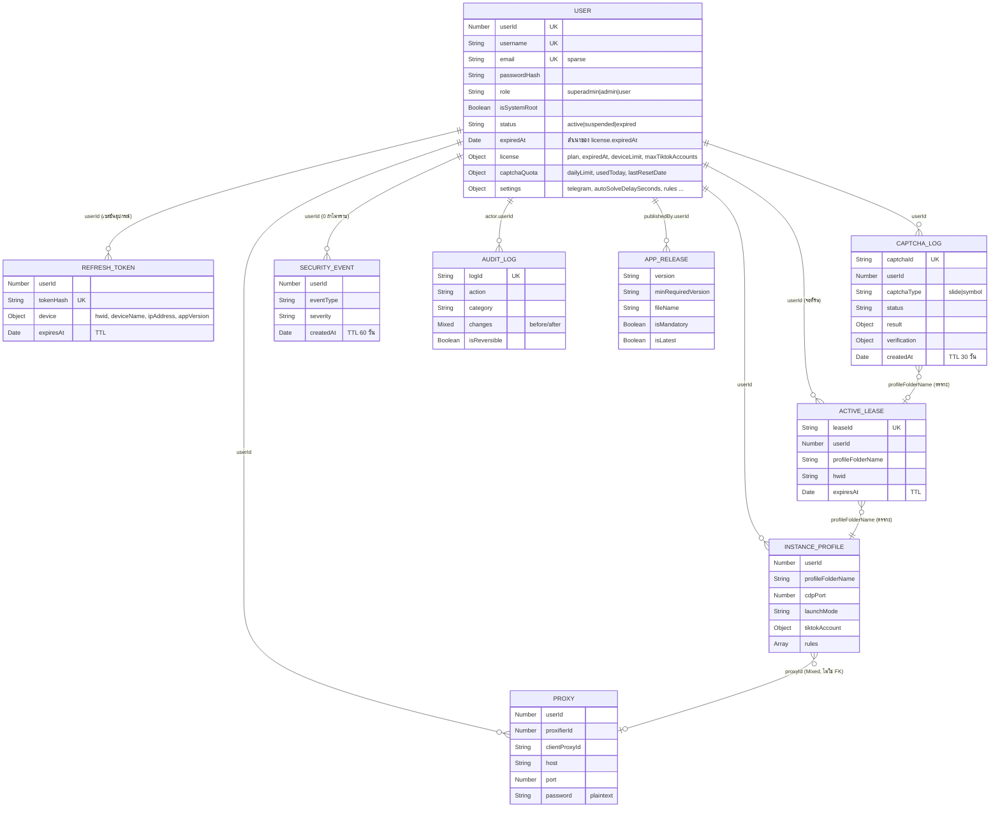

# Data Model — MongoDB / Mongoose

อัปเดตล่าสุด: 2026-10-20 · เวอร์ชัน backend: 1.0.0 (`package.json`) · เวอร์ชันแอป client: 1.7.0

โค้ดต้นฉบับ: [src/models/](../src/models/) (9 ไฟล์) · เชื่อมต่อผ่าน [src/config/db.ts](../src/config/db.ts) (`mongoose.connect`, ไม่มี option พิเศษ) · ฐานข้อมูล default ชื่อ `flowultratech` (ตั้งได้จาก `MONGODB_URI`)

## ภาพรวม collection

ชื่อ collection ได้จาก default ของ Mongoose (พหูพจน์ ตัวพิมพ์เล็ก) ยกเว้น 2 ตัวที่ระบุชื่อเอง

| Model | Collection | หน้าที่ | TTL | ไฟล์ |
| --- | --- | --- | --- | --- |
| `User` | `users` | บัญชี, license, โควต้าจอ, โควต้า captcha, settings | – | [User.ts](../src/models/User.ts) |
| `RefreshToken` | `refreshtokens` | เซสชัน/อุปกรณ์ที่ล็อกอิน | `expiresAt` (0 วินาที = ลบเมื่อถึงเวลา) | [RefreshToken.ts](../src/models/RefreshToken.ts) |
| `ActiveLease` | `activeleases` | ตั๋วจอที่กำลังรัน (Slot Lease) | `expiresAt` (0 วินาที) | [ActiveLease.ts](../src/models/ActiveLease.ts) |
| `InstanceProfile` | `instanceprofiles` | โปรไฟล์ TikTok Studio + กฎตอบอัตโนมัติ (sync จาก client) | – | [InstanceProfile.ts](../src/models/InstanceProfile.ts) |
| `Proxy` | `proxies` | proxy ของผู้ใช้ (sync จาก client) | – | [Proxy.ts](../src/models/Proxy.ts) |
| `CaptchaLog` | `captchalogs` | ประวัติการแก้ captcha พร้อมรูป base64 | `createdAt` **30 วัน** (2,592,000 วินาที) | [CaptchaLog.ts](../src/models/CaptchaLog.ts) |
| `SecurityEvent` | `securityevents` | เหตุการณ์ผิดปกติ/ความปลอดภัย | `createdAt` **60 วัน** (5,184,000 วินาที) | [SecurityEvent.ts](../src/models/SecurityEvent.ts) |
| `AuditLog` | `audit_logs` | บันทึกการกระทำของแอดมิน + ข้อมูลสำหรับ revert | – (ไม่หมดอายุ) | [AuditLog.ts](../src/models/AuditLog.ts) |
| `AppRelease` | `app_releases` | รุ่นของตัวติดตั้ง/ประกาศอัปเดต | – | [AppRelease.ts](../src/models/AppRelease.ts) |

> เอกสารเก่ากล่าวถึง "5 คอลเลกชัน" และชื่อ `refresh_tokens`, `instance_profiles`, `captcha_logs` ซึ่งไม่ตรงกับโค้ดปัจจุบัน (ชื่อจริงดูตารางบน และมี 9 collection)

## ความสัมพันธ์ (ER)

ความสัมพันธ์เชื่อมกันด้วย **`userId` (Number)** เป็นหลัก ไม่มี foreign key จริงในฐานข้อมูล; บาง collection มี `userRef` (ObjectId → `users._id`) เป็น field เสริมที่ไม่บังคับ

## รายละเอียดแต่ละ model

### `User` (`users`)

| Field | ชนิด / ค่า | หมายเหตุ |
| --- | --- | --- |
| `userId` | Number, unique, index | root = `1000000`; ผู้ใช้ใหม่ = (userId สูงสุด + 1) เริ่ม `1000001` |
| `username` | String, unique, lowercase, trim | login ใช้ตัวพิมพ์เล็กเสมอ |
| `email` | String, unique + sparse | ไม่บังคับ |
| `passwordHash` | String (bcrypt) | login รองรับกรณีเก็บ plaintext เก่า: ถ้า `passwordHash === password` จะ hash ใหม่ให้ |
| `role` | `superadmin` / `admin` / `user` | default `user` |
| `isSystemRoot` | Boolean | root ถูกป้องกันด้วย `protectRoot` และข้ามการตรวจ license/โควต้า |
| `status` | `active` / `suspended` / `expired`, index | `/auth/me` ตั้ง `expired` อัตโนมัติเมื่อ license หมดอายุ |
| `expiredAt` | Date, index | **ซ้ำซ้อน** กับ `license.expiredAt` — `pre("save")` ซิงก์ให้ตรงกัน (script `sync_expired_at.ts` ใช้ย้ายข้อมูลเก่า) |
| `license.plan` | String, default `standard` | root = `unlimited_root` |
| `license.expiredAt` | Date, required, index | ค่าที่ใช้ตัดสินหมดอายุจริง |
| `license.deviceLimit` | Number, default 9999, min 1 | **เก็บและส่งกลับใน API แต่ไม่ถูกใช้บังคับ** (ตั้งแต่ client v1.3.0 ยกเลิกการจำกัดเครื่อง) |
| `license.maxTiktokAccounts` | Number, default 1, min 1 | โควต้าจอพร้อมกัน — ใช้จริงใน `slots/acquire` และ heartbeat; root = 999 ในฐานข้อมูล แต่โค้ด slots ใช้ 9999 สำหรับ root |
| `captchaQuota.dailyLimit` | Number, default 200 | ค่าปกติ = `maxTiktokAccounts × 200` (`CAPTCHAS_PER_TIKTOK_ACCOUNT = 200`); `pre("save")` ตั้งให้เมื่อสร้างใหม่ |
| `captchaQuota.usedToday` / `lastResetDate` | Number / Date | รีเซ็ตแบบ lazy เมื่อมีคำขอ captcha ข้ามวัน UTC |
| `settings` | Object | `telegramBotToken`, `telegramChatId`, `autoSolveDelaySeconds`(5), `captchaSoundVolume`(80), `autoSaveCaptchaImage`(true), `rules` (Mixed array) — เก็บ token แบบ plaintext |
| `createdAt`/`updatedAt` | timestamps | |

### `RefreshToken` (`refreshtokens`)

| Field | หมายเหตุ |
| --- | --- |
| `userRef` (ObjectId, ref User, index), `userId` (Number, index) | |
| `tokenHash` | SHA-256 ของ refresh token ดิบ, **unique** — ค่าคงที่ตลอดอายุ (ไม่หมุน) |
| `device.hwid` (required), `deviceName`, `ipAddress`, `appVersion` | ค่าที่ client ส่งตอน login; client desktop ส่งเฉพาะ `hwid` ดังนั้น `deviceName`/`appVersion` มักเป็น default (`Unknown Device`, `1.0.0`) |
| `expiresAt` | TTL index (`expireAfterSeconds: 0`) ต่ออายุ +30 วันทุกครั้งที่ refresh |
| index เพิ่ม | `{ userId: 1, "device.hwid": 1 }` |

ใช้เพื่อ: ตรวจ refresh, แสดงจำนวนเครื่อง (`activeDeviceCount` ใน admin), และ `reset-devices`

### `ActiveLease` (`activeleases`)

| Field | หมายเหตุ |
| --- | --- |
| `leaseId` | `lease_<32 hex>`, unique |
| `userId`, `profileFolderName`, `hwid`, `ipAddress`, `expiresAt` | `hwid` default `unknown-hwid` เมื่อ client ไม่ส่ง |
| index | TTL ที่ `expiresAt`; **unique `{userId, profileFolderName}`** (1 โปรไฟล์ = 1 lease; acquire ซ้ำจะเปลี่ยน `leaseId` ใหม่) |

TTL ของ lease = 10 นาทีที่ต่ออายุทุก heartbeat; process TTL monitor ของ MongoDB ลบทุก ~60 วินาที จึงอาจเห็น lease หมดอายุค้างสั้น ๆ — โค้ดทุกจุดกรองด้วย `expiresAt > now` เสมอ

### `InstanceProfile` (`instanceprofiles`)

`userRef`, `userId`, `clientProfileId`, `name`(required), `profileFolderName`(required), `cdpPort`(required), `launchMode` (`DirectProfile`/`Sandboxie`), `proxyId` (Mixed — ObjectId/string/null), `streamerUsername`, `customChromiumFlags`, `tiktokAccount{isLoggedIn, tiktokUid, displayId, nickname, avatarUrl, lastSyncAt}`, `rules[]` (`id, name, isEnabled, triggerType, pattern, isRegex, minDiamonds, responseTemplate, cooldownSeconds`)
index: unique `{userId, profileFolderName}`

### `Proxy` (`proxies`)

`userRef`, `userId`, `clientProxyId`, `name`, `host`, `port`, `protocol` (`socks5`/`http`), `username`, `password` (**plaintext**), `proxifierId`(required), `isActive`
index: `{userId, proxifierId}` และ `{userId, clientProxyId}` (ไม่ใช่ unique — ต่างจากเอกสารเก่า)

### `CaptchaLog` (`captchalogs`)

| กลุ่ม | Field |
| --- | --- |
| ระบุตัว | `captchaId` (UUID, unique), `userRef`, `userId`, `username`, `profileFolderName` (default `Acc01`), `captchaType` (`slide`/`symbol`), `appVersion`, `aiVersion` |
| รูป | `imageFilename`, `imageWithPositionFilename`, `imageSize`, `imageBase64` (data URL เต็ม), `imageWidth/Height`, `displayWidth/Height` |
| สถานะ | `status`: `CALCULATED` → `VERIFIED_SUCCESS` / `VERIFIED_FAILED`; `SOLVE_FAILED`; `TIMEOUT` (มีใน enum แต่ไม่พบโค้ดที่ตั้งค่านี้) |
| ผลลัพธ์ | `result{position, targetX, symbolPositions, rawPosition, rawSymbolPositions, holeBox, scaleX, scaleY, durationSec, success, errorMessage}` — `success` เป็น `false` จนกว่า client รายงาน `VERIFIED_SUCCESS` |
| ยืนยัน | `verification{verifiedAt, feedbackText, attempts, actualDurationSec}` |
| อื่น ๆ | `clientIp` |
| index | TTL `createdAt` 30 วัน; `{userId:1, createdAt:-1}`; `{status:1, createdAt:-1}`; field index: `captchaId`, `userRef`, `userId`, `username`, `appVersion`, `status` |

โควต้ารายโปรไฟล์/วัน คำนวณจาก `countDocuments({userId, profileFolderName, status≠SOLVE_FAILED, createdAt≥00:00 UTC})`

### `SecurityEvent` (`securityevents`)

`userId`(required), `eventType` (string อิสระ; ค่าที่โค้ดฝั่ง server ใช้: `MULTIPLE_INSTANCE_ATTEMPT`, `EXPIRED_LEASE_ABUSE`, `ROOT_PROTECTION_TRIGGERED`; ค่าที่ client ส่ง: `LICENSE_EXPIRED_KICKOUT`, `REALTIME_LICENSE_KICKOUT`; type ยังประกาศ `HWID_MISMATCH`, `CONCURRENT_IP`, `RATE_LIMIT_EXCEEDED` แต่ไม่พบโค้ดที่สร้าง), `details` (Mixed), `ipAddress`, `hwid`, `severity` (`low`/`medium`/`high`/`critical`, default `medium`), `createdAt` (ไม่มี `updatedAt`)
index: TTL `createdAt` 60 วัน; `userId`, `eventType`

### `AuditLog` (`audit_logs`)

| Field | หมายเหตุ |
| --- | --- |
| `logId` | UUID, unique |
| `timestamp` | default now, index |
| `actor{userId, username, role, ipAddress}` | |
| `action` | enum: `USER_CREATE`, `USER_UPDATE`, `USER_DELETE`, `USER_GRACE_PERIOD`, `DEVICE_RESET`, `LEASE_RELEASE`, `CAPTCHA_SOLVE`, `AUDIT_REVERT`, `SECURITY_INCIDENT`, `APP_RELEASE` (`CAPTCHA_SOLVE` ไม่พบโค้ดที่สร้าง) |
| `category` | `user` / `lease` / `captcha` / `security` / `system` |
| `targetId`, `targetType`, `summary` | |
| `changes{before, after}` | Mixed — snapshot ทั้ง document (รวม `passwordHash` ของ user ใน before/after) |
| `isReversible`, `isReverted`, `revertedAt`, `revertedBy`, `revertLogId`, `metadata` | |
| index | field index: `logId`, `timestamp`, `action`, `category`, `targetId`, `isReversible`, `isReverted` |

### `AppRelease` (`app_releases`)

`version`(index), `minRequiredVersion` (default `1.0.0`), `title`, `description`, `fileName`, `fileSize`, `fileHash` (SHA-256 hex), `downloadUrl`, `isMandatory`, `isLatest`(index), `publishedBy{userId, username}`, `publishedAt`(index), `downloadsCount`
ไม่มี unique บน `version` — broadcast ซ้ำเวอร์ชันเดิมสร้างเอกสารซ้ำ

## ข้อมูลที่ไม่ได้อยู่ใน MongoDB

| ข้อมูล | ที่เก็บ | อายุ |
| --- | --- | --- |
| Online session (Socket) | หน่วยความจำ ([socketHub.ts](../src/services/socketHub.ts) `onlineSessions`) | หายเมื่อ restart |
| Cache | หน่วยความจำ ([cacheManager.ts](../src/services/cacheManager.ts)) | TTL ตามคีย์ |
| รูป captcha | `storage/captchas/` (+ `_placed.png`) | purge ไฟล์เก่ากว่า 7 วันเฉพาะตอน boot |
| ตัวติดตั้ง | `storage/releases/*.exe` | ถาวร (ไม่ใน git) |

## ข้อสังเกต/ช่องว่าง (ยังไม่ยืนยันจากโค้ด)

- ไม่มีสคริปต์ migration นอกจาก [`sync_expired_at.ts`](../scripts/sync_expired_at.ts); ฐานข้อมูลจริงอาจมีเอกสาร `User` รุ่นเก่า (เช่น `deviceLimit` = 1) ที่ไม่ตรง default ปัจจุบัน
- `CaptchaLog.status = TIMEOUT` และ `AuditAction CAPTCHA_SOLVE` ถูกประกาศ แต่ไม่พบจุดที่สร้างค่าในโค้ด
- การลบ `captchalogs` ทำตาม TTL 30 วันเท่านั้น ไม่ได้ลบไฟล์ใน `storage/captchas/` พร้อมกัน
