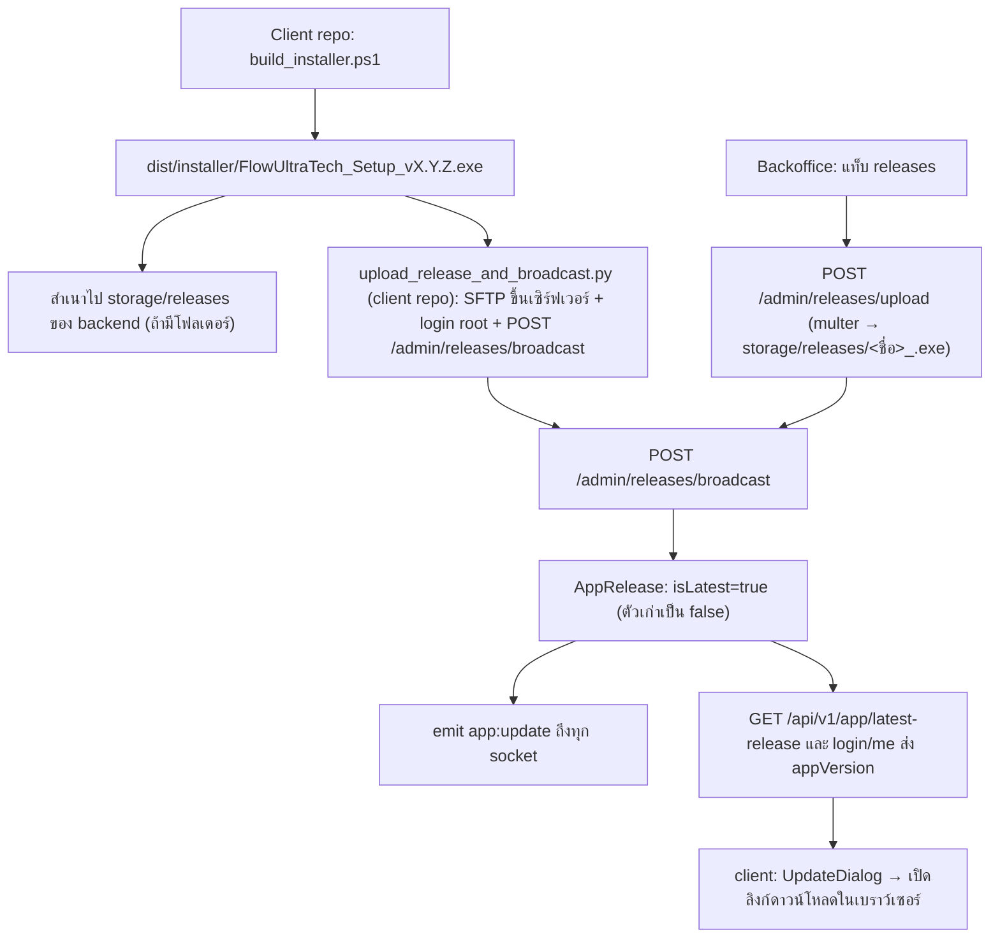

# Operations & Backoffice

อัปเดตล่าสุด: 2026-10-20 · เวอร์ชัน backend: 1.0.0 (`package.json`) · เวอร์ชันแอป client: 1.7.0

เอกสารนี้อธิบายสิ่งที่ทำงานเบื้องหลัง (bootstrap, cache, audit, security events, Telegram), Backoffice, การจัดเก็บ/แจกจ่ายตัวติดตั้ง, สคริปต์ deploy และชุดทดสอบ — **สคริปต์ทุกตัวในเอกสารนี้อธิบายจากการอ่านโค้ด ไม่ได้รัน**

## 1. Bootstrap และ seed

ลำดับใน [`main()` ของ server.ts](../src/server.ts): `installProcessHandlers` (log `unhandledRejection`/`uncaughtException` แต่ไม่ปิดโปรเซส) → `connectDb` (ล้มเหลว = `process.exit(1)`) → `ensureRootUser`, `ensureTestUser` (ล้มเหลว = log แล้วทำงานต่อ) → `ensureImageDirs` (สร้าง `storage/captchas`, purge ไฟล์เก่ากว่า 7 วันครั้งเดียวตอน boot) → `buildApp` + `initSocketHub` → listen → prewarm Python symbol daemon

| ฟังก์ชัน ([bootstrap.ts](../src/services/bootstrap.ts)) | พฤติกรรม |
| --- | --- |
| `ensureRootUser` | หา user ที่ `username = ROOT_USERNAME` หรือ `isSystemRoot=true`; ไม่มี → สร้าง `userId=1000000`, role `superadmin`, `isSystemRoot`, license plan `unlimited_root` อายุ 100 ปี, `maxTiktokAccounts`/`deviceLimit` = 999, `dailyLimit` 999,999 · **มีแล้ว → ซิงก์ทุก boot**: ตั้งรหัสผ่านเป็นค่าจาก `ROOT_PASSWORD` ใหม่ถ้าไม่ตรง, บังคับ `username/role/isSystemRoot/status`, บังคับโควต้า 999 (ดังนั้นเปลี่ยนรหัส root ผ่าน Backoffice ไม่ได้ผลข้าม restart) |
| `ensureTestUser` | ทำงานเฉพาะเมื่อ `ENABLE_TEST_USER="true"`: สร้าง user `test` (`userId=1000001`, role user, โควต้า 10 จอ) ถ้ายังไม่มี รหัสผ่านเริ่มต้นเท่ากับ username |
| [`scripts/reset_and_seed_db.ts`](../scripts/reset_and_seed_db.ts) | **ลบข้อมูลทั้งหมด** ใน `users, audit_logs, captchalogs, activeleases, refreshtokens, securityevents, instanceprofiles` (ไม่แตะ `proxies`, `app_releases`) แล้วสร้าง root + `test1`–`test10` (รหัสผ่านเท่ากับ username, 1 จอ) ไม่มี npm script (ต้องรันด้วย `tsx` เอง) ห้ามรันกับฐาน production |
| [`scripts/sync_expired_at.ts`](../scripts/sync_expired_at.ts) | migration: คัดลอก `license.expiredAt` → `expiredAt` ให้ทุก user (`user.save()` ทีละคน) |

## 2. Cache (หน่วยความจำ)

[`cacheManager`](../src/services/cacheManager.ts): `Map` ใน process เดียว (ไม่แชร์ข้ามหลาย instance), TTL ระดับวินาที, prune ทุก 60 วินาที, นับ hit/miss (`getMetrics()` → `/admin/stats`, `/admin/cache-stats`)

| คีย์ | TTL | ใช้ที่ | ล้างโดย |
| --- | --- | --- | --- |
| `user:id:<userId>` | 60 วินาที | `verifyActiveLease`, `requireAdmin`, `requireSuperAdmin` | `delPrefix("user:")` เมื่อสร้าง/แก้/ลบ user, revert |
| `lease:<leaseId>` | 15 วินาที | `verifyActiveLease`; heartbeat เขียน object ลงคีย์นี้ | `release`, `releaseLease`, `updateUser` (ลดโควต้า) |
| `user_license_<userId>` | 30 วินาที | HTTP `slots/heartbeat` | เฉพาะตอน heartbeat พบ user ไม่ active/หมดอายุ — **ไม่ถูกล้างโดย `delPrefix("user:")`** (prefix ไม่ตรง) จึงอาจเห็นสถานะ user เก่าได้ถึง 30 วินาทีหลังแอดมินแก้ |
| `stats:dashboard` | 4 วินาที | `GET /admin/stats` | ล้างเมื่อแก้ user/ปลด lease |
| `device:*` | – | ล้างด้วย `delPrefix("device:")` ตอน reset-devices/revert แต่ไม่พบโค้ดที่เขียนคีย์นี้ | – |

## 3. Audit log และ Revert

[`recordAuditLog`](../src/services/auditLogger.ts) เขียน `AuditLog` (UUID `logId`) แล้ว emit `audit:logged` ไป `admin_room` (ล้มเหลวจะ log แล้วคืน `null` ไม่ทำให้ request พัง)

| ผู้เรียก | action | category | `isReversible` |
| --- | --- | --- | --- |
| `createUser` | `USER_CREATE` | user | true |
| `updateUser` | `USER_UPDATE` | user | true |
| `grantGracePeriod` | `USER_GRACE_PERIOD` | user | true |
| `deleteUser` | `USER_DELETE` | user | true |
| `resetDevices` | `DEVICE_RESET` | security | true |
| `releaseLease` | `LEASE_RELEASE` | lease | true |
| `broadcastRelease` | `APP_RELEASE` | system | false |
| `POST /security/event` | `SECURITY_INCIDENT` | security | false |
| `executeRevert` | `AUDIT_REVERT` | user/security/lease | false |

[`executeRevert`](../src/services/auditLogger.ts) (เรียกจาก `POST /admin/logs/:id/revert`, เฉพาะ superadmin) — ปฏิเสธถ้าไม่ reversible หรือย้อนไปแล้ว

| action เดิม | การย้อนคืน |
| --- | --- |
| `USER_UPDATE`, `USER_GRACE_PERIOD` | เขียน `license, status, role, email, settings, captchaQuota, passwordHash` กลับจาก snapshot `before` |
| `USER_DELETE` | สร้าง user ใหม่จาก snapshot (ล้มเหลวถ้า username ซ้ำ) — **ไม่คืน refresh token/lease/โปรไฟล์/proxy ที่ถูกลบไปพร้อมกัน** |
| `USER_CREATE` | ลบ user (ห้ามถ้าเป็น root) |
| `DEVICE_RESET` | `insertMany` refresh token เดิมกลับ (ผู้ใช้กลับมาล็อกอินค้างได้) |
| `LEASE_RELEASE` | สร้าง lease ใหม่อายุ 60 วินาที |
| action อื่น | โยน error `Revert not supported` |

## 4. Security events

บันทึกลง `securityevents` (TTL 60 วัน) และ (บางจุด) push `security:alert` ไป `admin_room`

| eventType | ผู้สร้าง | severity | เงื่อนไข |
| --- | --- | --- | --- |
| `MULTIPLE_INSTANCE_ATTEMPT` | `slots/acquire` | medium | จอที่เปิดอยู่ ≥ `maxTiktokAccounts` |
| `EXPIRED_LEASE_ABUSE` | `verifyActiveLease` | medium / high | lease หมดอายุ-ไม่พบ (medium); lease คนละ user หรือ HWID ไม่ตรง (high) |
| `ROOT_PROTECTION_TRIGGERED` | `protectRoot` | critical (ลบ root) / high (ระงับ root) | |
| `LICENSE_EXPIRED_KICKOUT`, `REALTIME_LICENSE_KICKOUT` | client ผ่าน `POST /security/event` | medium (default) | client ถูกเตะออก |
| ชนิดอื่น | client ส่งอะไรมาก็ได้ | ตามที่ส่ง | ไม่มี whitelist |

หมายเหตุ: `HWID_MISMATCH`, `CONCURRENT_IP`, `RATE_LIMIT_EXCEEDED` อยู่ใน type แต่ไม่มีโค้ดที่สร้าง และ Backoffice ที่ build อยู่ไม่มีหน้า Security โดยเฉพาะ (ดูหัวข้อ 7)

## 5. Telegram

[`telegramService.ts`](../src/services/telegramService.ts): `sendTelegramMessage` และ `sendTelegramPhoto` เรียก Telegram Bot API ด้วย `fetch` (HTML parse mode); ใช้ bot token ของผู้ใช้ (`user.settings.telegramBotToken`) ถ้าว่างใช้ `TELEGRAM_DEFAULT_BOT_TOKEN`; ไม่มี chat id/ข้อความ → คืน `false`

ผู้เรียกมีที่เดียวคือ [captcha.ts](../src/routes/captcha.ts): ส่ง **รูปที่แก้พร้อม overlay** ทันทีที่ได้ผล (background) และส่ง **ข้อความผล** (สำเร็จ/ถูกปฏิเสธ) เมื่อ client เรียก feedback ครั้งแรก — ส่งเฉพาะผู้ใช้ที่ตั้ง `telegramChatId` ไม่ผ่านการจำกัดอัตรา

## 6. Online session และ remote log (Socket)

`onlineSessions` เป็น Map ในหน่วยความจำ key = `socket.id` (ข้อมูล: userId, username, role, IP จาก `x-forwarded-for`/handshake, `appVersion`, `hwid`, `hostname`, `runningCount/totalCount`, `instances[]`) — ใช้ใน `GET /admin/online-users`, event `admin:online_users_updated`, และตัวนับในแท็บ "ผู้ใช้ออนไลน์ & จอสด" ของ Backoffice ข้อมูลหายเมื่อ restart จนกว่า client ส่ง `client:instances_report` ใหม่ (client ส่งตอน connect และเมื่อสถานะ instance เปลี่ยน)

ฟีเจอร์ดึง log จากเครื่อง client: admin emit `admin:fetch_instance_logs` → server ส่ง `cmd:get_instance_logs` → client อ่านไฟล์ log แล้วตอบ `client:instance_logs_response` → relay ไป `admin_room`; timeout 15 วินาที

## 7. Backoffice

### ที่มาและการ build

| หัวข้อ | รายละเอียด |
| --- | --- |
| Source | **ไม่อยู่ใน backend repo** (`backoffice/` ถูก gitignore เหลือแค่ `backoffice/dist/`) source อยู่ที่โปรเจกต์พี่น้อง `d:\Script\java-script\backoffice` (React 19 + Vite 8 + Tailwind 4 + `socket.io-client` + `lucide-react`; ไม่ใช่ git repo) |
| Dev | `npm run dev` ในโปรเจกต์ backoffice → `http://localhost:5173` มี proxy `/api` และ `/storage` ไป `http://localhost:8001` |
| Build | `npm run build` (`tsc -b && vite build`, `base: './'`) → `dist/` แล้วคัดลอกมาที่ `<backend>/backoffice/dist` (สคริปต์ `deploy_update.py` อัปโหลด `d:\Script\java-script\backoffice\dist` ถ้ามี ไม่งั้นใช้ `backoffice/dist` ใน repo) |
| การเสิร์ฟ | [`backofficeRouter`](../src/routes/backoffice.ts) ที่ `/backoffice` และ `/admin`: หา `dist` จาก 3 candidate (`<cwd>/backoffice/dist`, `<cwd>/../backoffice/dist`, `<cwd>/dist/backoffice`) ที่มี `index.html`; SPA fallback ทุก path; ไม่มี dist → 503 |
| `dist/assets` | สะสมไฟล์ hash เก่าหลาย build (เช่น `index-*.js` 14 ชุด) — `index.html` ปัจจุบันอ้าง `index-Bt3WmorN.js` เท่านั้น ไฟล์อื่นคือซากรุ่นก่อน (รวม chunk `LiveLeasesTab`, `SecurityTab` ที่ไม่ถูกโหลดแล้ว) |

### การยืนยันตัวตนและการเชื่อมต่อ

- หน้า login เรียก `POST /api/v1/auth/login` ด้วย `hwid = "BACKOFFICE-WEB-CLIENT"`, `deviceName = "Backoffice Web Admin"`; เก็บ access token ใน `localStorage` คีย์ `tt_backoffice_token` และข้อมูลผู้ใช้ใน `tt_backoffice_user`; ทุก request แนบ `Authorization: Bearer`; ได้ 401 → ล้างและกลับหน้า login
- Socket: `io(origin, {auth:{token, clientType:"backoffice"}, query:{clientType:"backoffice"}})` ฟัง `lease:changed`, `user:updated`, `user:quota_reduced`, `user:kickout`, `captcha:status_changed`, `admin:online_users_updated` เพื่อรีเฟรชตัวเลข/ตาราง; แท็บ "ผู้ใช้ออนไลน์" ใช้ `admin:fetch_instance_logs`
- ตัวเลขการ์ดด้านบน (`StatsCards`) มาจาก `GET /admin/stats`: ผู้ใช้ทั้งหมด/active, จอที่รันสด, เครื่องออนไลน์ (จำนวน HWID ใน refresh token), สถานะ MongoDB

### เมนู/หน้า (ตาม `App.tsx` ที่ build ปัจจุบัน)

| แท็บ (id) | ชื่อใน UI | สิทธิ์ที่เห็น | ทำอะไรได้ | API ที่ใช้ |
| --- | --- | --- | --- | --- |
| `users` | ผู้ใช้งาน & โควต้า | admin+ | ค้นหา/กรอง role/แบ่งหน้า, สร้าง/แก้/ลบ user, ตั้งโควต้าจอ (`maxTiktokAccounts`), ต่ออายุ (+วัน/+ชั่วโมง/Grace Period 2 ชม.), เปลี่ยนสถานะ/role, รีเซ็ต session อุปกรณ์ (ฟอร์มแก้ไขส่ง `deviceLimit: 9999` ตายตัว) | `/admin/users*`, `/grace-period`, `/reset-devices` |
| `leases` | ผู้ใช้ออนไลน์ & จอสด | admin+ | รายชื่อ client ที่เชื่อมต่อ socket พร้อม instance/ช่อง TikTok/uptime/สถานะ captcha, ปลด lease, ดู log สดจากเครื่อง client (ดาวน์โหลด `.log`) | `/admin/online-users`, `DELETE /admin/leases/:id`, socket |
| `captcha` | ประวัติ Captcha | แสดงให้ทุกคนที่เป็น admin (แต่ API เป็น **superadmin เท่านั้น** → admin ทั่วไปจะได้ 403) | กรอง slide/symbol/สถานะ, ดูรูปต้นฉบับ/รูปวางตำแหน่ง/พิกัด/เวลา/เวอร์ชันแอป | `/admin/captcha-logs`, `/admin/captchas/:file/image` |
| `logs` | บันทึกกิจกรรม & กู้คืน | **superadmin** | กรอง category/action/สถานะ revert, ย้อนคืน (revert) | `/admin/logs`, `/admin/logs/:id/revert` |
| `releases` | อัปเดตเวอร์ชัน & บรอดแคสต์ | **superadmin** | อัปโหลดตัวติดตั้ง (ตรวจเวอร์ชัน + SHA-256), ตั้ง min version/บังคับอัปเดต, broadcast, ดูรายการรุ่น | `/admin/releases/upload`, `/broadcast`, `GET /admin/releases` |

ใน repo ของ Backoffice ยังมี `LiveLeasesTab.tsx` (ไม่ถูก import แล้ว) และ `LogViewerModal.tsx` (ใช้ในแท็บ leases)

### จุดที่โค้ด Backoffice กับ API ไม่ตรงกัน (จากการอ่าน source/dist ทั้งสองฝั่ง ไม่ได้รันยืนยัน)

- `api.getActiveLeases()` อ่าน `res.activeLeases` แต่ `GET /admin/leases` ตอบ `{leases:[...]}` → ตัวนับ lease จะได้อาร์เรย์ว่างจนกว่า socket `admin:online_users_updated` จะอัปเดต
- `api.getAuditLogs()` ส่ง query `isReverted` แต่ controller อ่าน `reverted` → ตัวกรองสถานะ revert ไม่มีผล
- แท็บ `captcha` เปิดให้ admin ทั่วไปเห็นแต่ API ปฏิเสธ (superadmin เท่านั้น)

## 8. Release และตัวติดตั้ง (storage)

| รายการ | พฤติกรรมจากโค้ด |
| --- | --- |
| `POST /admin/releases/upload` | multer ตั้งชื่อ `<ชื่อเดิมที่ sanitize>_<Date.now()>.exe` ลง `storage/releases/`; `detectFileVersion`: ดึง semver จากชื่อไฟล์ก่อน → ไม่ได้และเป็น `.exe` อ่าน 5 MB แรกหา `ProductVersion/FileVersion` → ไม่ได้ใช้ `1.0.0`; คำนวณ SHA-256 ทั้งไฟล์ **ยังไม่สร้าง `AppRelease`** |
| `POST /admin/releases/broadcast` | สร้าง `AppRelease` ใหม่ด้วยค่าที่ส่งมา (ไม่ตรวจว่าไฟล์มีจริง ไม่ตรวจ hash/ขนาด) แล้ว broadcast |
| `downloadUrl` ที่ client เห็น | ถ้า `downloadUrl` ขึ้นต้น `/storage/releases/` ฝั่ง login/me จะแปลงเป็น `/api/v1/app/download?version=<v>` และเติม `protocol://host` |
| บังคับอัปเดต | server ส่ง `isMandatory` + `minRequiredVersion`; ฝั่ง client ตัดสิน (ดู client doc) — server **ไม่ปฏิเสธ** login/API ของ client เวอร์ชันต่ำกว่า min |
| `X-App-Version` | บันทึกใน `CaptchaLog.appVersion` เพื่อดูเท่านั้น ไม่ใช้บล็อก |
| ไฟล์ที่มีอยู่ใน `storage/releases/` (ตอนอ่าน) | `FlowUltraTech_Setup_v1.0.1`–`v1.7.0` (12 ไฟล์) และ `TikTokStudioSandbox_Setup_v0.1.0`–`v1.0.0` (11 ไฟล์ ชื่อเก่าก่อนเปลี่ยนแบรนด์) |

## 9. สคริปต์ใน `scripts/` (backend repo) — อธิบายเท่านั้น ห้ามรันโดยไม่ตั้งใจ

| ไฟล์ | ทำอะไร | ผลกระทบ |
| --- | --- | --- |
| [`deploy_update.py`](../scripts/deploy_update.py) (`npm run deploy`) | SSH/SFTP (paramiko) ไปเซิร์ฟเวอร์ production: อัปโหลด `src/`, `python/` (ยกเว้น `full_debug`, `__pycache__`), `package.json`, `tsconfig.json`, `scripts/*.ts`, `tests/test_realtime_socket.ts`, `backoffice/dist`, `public/`, ตัวติดตั้งใน `storage/releases` (เทียบขนาด) → `npm install && npm run build` ระยะไกล → เขียน `app_releases` ผ่าน `mongosh` (ตั้ง **`isMandatory: true`, `minRequiredVersion` = เวอร์ชันล่าสุดจากชื่อไฟล์ `FlowUltraTech_Setup_v*`**, ข้อความ title/description ฝังในสคริปต์) → `pm2 restart flowultratech-backend` → ตรวจ endpoint ด้วย `curl` | แก้เซิร์ฟเวอร์จริง + ประกาศบังคับอัปเดตทุกครั้งที่รัน; ใช้ host ตายตัวและ credential ที่ฝังในไฟล์ |
| [`fix_releases_metadata.py`](../scripts/fix_releases_metadata.py) | คำนวณ size + SHA-256 ของ `.exe` ในโฟลเดอร์ releases ฝั่ง local แล้ว `updateOne` เข้า `app_releases` บนเซิร์ฟเวอร์ผ่าน `mongosh` (ฐาน `tiktok_sandbox`, path โปรเจกต์เก่า `SimpleSolveCaptchaProject`) | สคริปต์รุ่นเก่า ชี้ path/ฐานที่ไม่ตรงกับปัจจุบัน |
| [`verify_live.py`](../scripts/verify_live.py) | seed `AppRelease` v1.0.0 (ชื่อไฟล์ `TikTokStudioSandbox_Setup_v1.0.0.exe`) ผ่าน `mongosh` (ฐาน `tiktok_sandbox`) แล้ว `curl` ตรวจ `/`, `/download`, `/api/v1/app/*`, `/storage/releases/*`, `/backoffice/` | **ตั้ง `isLatest` ทุกรุ่นเป็น false แล้วตั้ง v1.0.0 เป็น latest** — อันตรายถ้ารันหลังมี v1.7.0 |
| [`reset_and_seed_db.ts`](../scripts/reset_and_seed_db.ts) | ดูหัวข้อ 1 | ลบข้อมูลผู้ใช้ทั้งหมด |
| [`sync_expired_at.ts`](../scripts/sync_expired_at.ts) | ดูหัวข้อ 1 | แก้ข้อมูล `users` |
| [`benchmark_simulation.py`](../scripts/benchmark_simulation.py) | จำลองใช้งานจริงกับ `SERVER_URL` (env, default เป็นเซิร์ฟเวอร์จริง): health/stats → login ทดสอบรหัสผิด/ถูก → `/me` → acquire/heartbeat → ยิง `/captcha/slide` N รอบ วัด latency → release; เขียนผลลง `scripts/benchmark_result.json` | ใช้โควต้า captcha ของบัญชีที่ใช้ทดสอบ |

ไฟล์ที่ root ของ backend repo: `simulate_live_user_app.cjs` (จำลอง client: login → acquire → socket `client:instances_report` + `slot:heartbeat` + ตอบ `cmd:get_instance_logs` → release; ชี้เซิร์ฟเวอร์จริง) และ `inspect-models.mjs` (อ่านโครงสร้าง input/output ของโมเดล ONNX)

## 10. ชุดทดสอบ (`tests/`)

ไม่มี test framework (ไม่มี jest/vitest) แต่ละไฟล์เป็นสคริปต์ที่รันเอง ผลลัพธ์ดูจาก console/exit code

| ไฟล์ | ชนิด | ทดสอบอะไร | เป้าหมาย / ข้อควรระวัง |
| --- | --- | --- | --- |
| `test-backend-full.mjs` (`npm run test:backend`) | integration (Node) | 9 หัวข้อ: root ใน Mongo, login root/test, `/me`, refresh token, `protectRoot` (ห้ามลบ/ระงับ root), admin CRUD user, slots acquire + จำกัดโควต้า, `verifyActiveLease` กับ captcha | เปิดแอปจาก `dist/` บนพอร์ต 3009 ตั้ง env ภายในไฟล์ (MongoDB local ฐาน `tiktok_sandbox`) และ **ลบ** user/lease/token/captchalog ของ user ที่สร้างเองตอนจบ ชื่อ "Refresh Token Rotation" ไม่ตรงกับโค้ด (ปัจจุบันไม่หมุน token) |
| `test_realtime_socket.ts` | e2e socket (tsx) | login admin+user → เชื่อม socket → ping ack → ลดโควต้า (`quota:reduced`) → grace +2 ชม./+30 วัน (`license:updated`) → acquire/release (`lease:changed`) → heartbeat ผ่าน socket → `audit:logged` | `TEST_SERVER_URL` (default `127.0.0.1:8001`) |
| `test_online_users_socket.ts` | e2e socket | online users / telemetry | ชี้เซิร์ฟเวอร์จริงแบบตายตัว |
| `test_audit_revert_cache.py` | e2e HTTP | แยก role admin/superadmin, ห้ามสร้าง superadmin, admin เข้า audit/cache-stats ไม่ได้, audit log + revert, cache stats | ชี้เซิร์ฟเวอร์จริง |
| `test_crud_and_captchas.py` | e2e HTTP | CRUD user, reset-devices, captcha | `SERVER_URL`/`ROOT_USER`/`ROOT_PASS` จาก env (มี default เป็นของจริง) |
| `test_verification_and_10users.py` | e2e HTTP | root + test1–test10 login, acquire lease, captcha → `CALCULATED`, feedback → `VERIFIED_SUCCESS`/`FAILED` | ต้อง seed ด้วย `reset_and_seed_db.ts` ก่อน; ชี้เซิร์ฟเวอร์จริง |
| `verify_license_and_quota.py` | e2e HTTP | ห้ามสร้าง superadmin, grace +2 ชม., โควต้าจริง | ชี้เซิร์ฟเวอร์จริง |
| `test-captcha-api.mjs`, `test-simple.mjs`, `test-symbol.mjs`, `test-all-images.mjs` | ทดสอบ solver ผ่าน HTTP | ชุด captcha รุ่นเก่า (พอร์ต 3005/3006, login `test`/`/login`) | ค่าเริ่มต้นล้าสมัย ต้องตั้ง `AUTH_URL`/`CAPTCHA_URL` เอง |
| `test-webp-decode.mjs` | unit-ish | ตรวจ `decodeBase64Image` กับ WebP จริง | อ่านไฟล์ HTML ตัวอย่างในเครื่อง |
| `scratch_*.mjs` (4 ไฟล์) | สคริปต์ลองผิดลองถูก | ตรวจ piece/slide/โมเดลกับ HTML ตัวอย่าง | import `dist/ml/slide.js`; ไม่ใช่ test จริง |

## 11. ข้อสังเกตด้านความปลอดภัยที่พบจากโค้ด

| # | ระดับ | ข้อสังเกต | ที่ |
| --- | --- | --- | --- |
| 1 | สูง | มี **ข้อมูลเข้าสู่ระบบจริงฝังในไฟล์ที่ track ใน git** (SSH ผู้ใช้ root ของเซิร์ฟเวอร์ production, รหัสผ่านบัญชี root ของแอป, IP เซิร์ฟเวอร์) ใน `scripts/deploy_update.py`, `fix_releases_metadata.py`, `verify_live.py`, `benchmark_simulation.py`, `simulate_live_user_app.cjs`, `tests/*` (หลายไฟล์), และ default ใน `reset_and_seed_db.ts`; ฝั่ง client repo มีลักษณะเดียวกัน (ดู client doc 12) — ควร rotate และย้ายไป env | ทั้งสอง repo (remote บน GitHub ไม่ทราบว่า private หรือไม่) |
| 2 | สูง | `app.use("/storage", express.static(...))` เปิดทั้ง `storage/` รวม `storage/captchas/` (รูปที่ผู้ใช้ส่งแก้ ชื่อไฟล์มี userId) ให้เข้าถึงได้โดยไม่ล็อกอิน หากรู้ชื่อไฟล์ | [app.ts](../src/app.ts) |
| 3 | กลาง | `ROOT_PASSWORD` มี default ในโค้ด (`env.ts`, `bootstrap.ts`) และ `.env.example`; รหัส root ถูกเขียนทับจาก env ทุก boot | [env.ts](../src/config/env.ts), [bootstrap.ts](../src/services/bootstrap.ts) |
| 4 | กลาง | access token ยอมรับผ่าน query `?token=` และ `showRequestLog` log `req.originalUrl` ทุก request → token หลุดลง log; cookie `flow_token` ไม่มี flag `Secure`; client desktop ใช้ endpoint แบบ `http://` | [auth.ts](../src/middlewares/auth.ts), [request.ts](../src/middlewares/request.ts) |
| 5 | กลาง | `resolveImageInput` ยอมรับ URL http(s) ใน `body.image` แล้ว `fetch` เอง (ผู้ใช้ที่มี lease ใช้ยิงจาก server ไปที่อยู่ภายในได้ — SSRF; จำกัดแค่ขนาดผลลัพธ์ 5 MB) | [utils/image.ts](../src/utils/image.ts) |
| 6 | กลาง | ไม่มี revocation: logout/ระงับบัญชีไม่ทำให้ access token (24 ชม. / 30 วัน สำหรับ admin) เป็นโมฆะ; `authenticateToken` ไม่ตรวจ status และ `verifyActiveLease`/`handleCaptcha` ไม่ตรวจ status หรือวันหมดอายุของ user (พึ่ง heartbeat ลบ lease ภายใน ≤ 10 นาที และ cache `user_license_` ค้างได้ 30 วินาที) | [auth.ts](../src/middlewares/auth.ts), [slots.ts](../src/routes/slots.ts) |
| 7 | กลาง | Socket event `admin:get_online_users` ไม่ตรวจ role → ผู้ใช้ที่ล็อกอินทุกคนอ่านรายชื่อออนไลน์ทั้งระบบ (HWID, hostname, IP, instance) ได้; `client:instance_logs_response` รับจาก socket ใดก็ได้ที่รู้ `requestId` (สร้างด้วย `Math.random`) | [socketHub.ts](../src/services/socketHub.ts) |
| 8 | กลาง | ข้อมูลอ่อนไหวเก็บ/ส่งกลับแบบ plaintext: รหัสผ่าน proxy (`GET /proxies`), `telegramBotToken` (`/auth/settings`, และ `GET /admin/users` ส่ง `settings` ของผู้ใช้ทุกคนให้ admin), `activeSessions[].tokenHash` ใน `GET /admin/users/:id`; `AuditLog.changes` เก็บ snapshot ที่มี `passwordHash` | models, adminController |
| 9 | ต่ำ-กลาง | `POST /security/event` ไม่มี rate limit/whitelist: ผู้ใช้ทั่วไปสร้าง event/audit log ปลอมและ push เข้าหน้าแอดมินได้ | [security.ts](../src/routes/security.ts) |
| 10 | ต่ำ | `cors()` เปิดทุก origin และ Socket.io `origin:"*"` + `credentials:true`; deploy script ใช้ `AutoAddPolicy` (ไม่ตรวจ host key) | [app.ts](../src/app.ts), scripts |

## ข้อสังเกต/ช่องว่าง (ยังไม่ยืนยันจากโค้ด)

- ไม่ทราบว่า `storage/captchas/` บนเซิร์ฟเวอร์จริงมีไฟล์อยู่หรือไม่ (ในเครื่องที่อ่านเป็นโฟลเดอร์ว่าง) จึงยังไม่ประเมินผลกระทบข้อ 2 จริง
- ไม่ทราบว่ามี firewall/nginx กั้น `/storage` หรือจำกัด IP ของ `/backoffice` หรือไม่
- cron/ตัวตั้งเวลาล้าง `storage/captchas` ระหว่างรัน: ไม่พบ (มี purge ตอน boot ครั้งเดียว) — หากเซิร์ฟเวอร์ไม่ restart นาน ไฟล์จะสะสม
- เอกสารไม่ครอบคลุมรายละเอียดอัลกอริทึม solver (`src/ml/*`, `python/*`) เพราะอยู่นอกขอบเขตงานนี้
